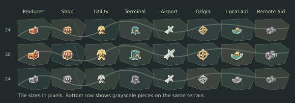
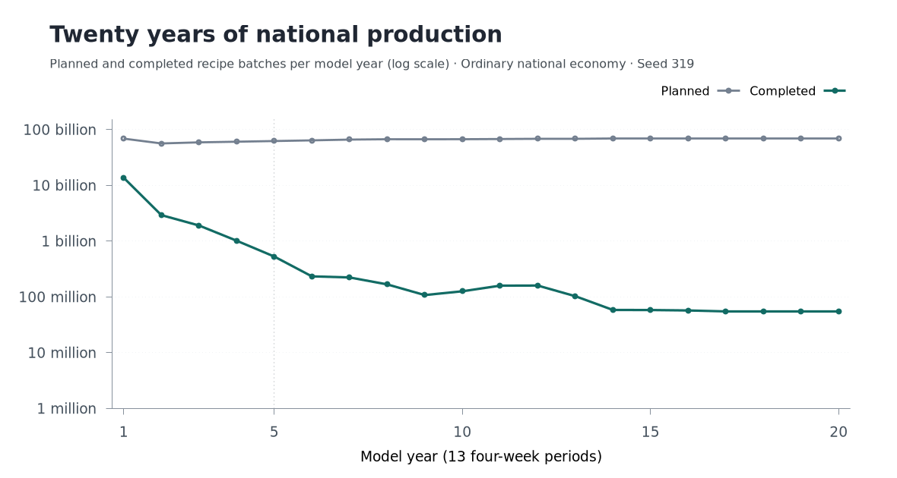
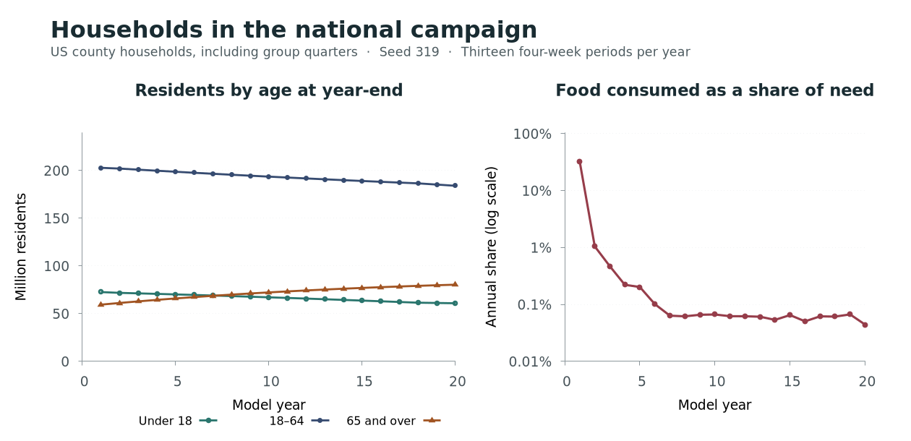
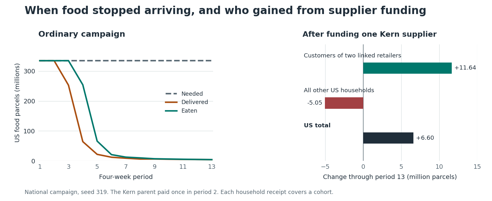

# Economic flows and company accounting on the local national campaign

Use the [local setup guide](../SETUP_GUIDE.md#inspect-a-company-or-freight-route) to open a national campaign and follow a payment from a county to a company’s books. The [household campaign](#five-and-twenty-years-with-births-aging-and-deaths) covers twenty model years. The [earlier economic run](#five-and-twenty-years-in-the-ordinary-national-economy) provides the fixed-population comparison. The [company comparisons](#repeating-the-company-comparisons-with-the-v9-policy) use two seeds to distinguish investment choices from equipment purchases. The [first-turn measurements](#the-first-turn-of-a-new-national-observer-campaign) record when the observer shows Wayne’s financial figures and how much storage and memory the running game uses.

The [food shortage](#when-food-stopped-reaching-households) shows when deliveries failed and who still had food at home. The [supplier funding experiment](#what-changed-when-owners-funded-essential-suppliers) follows four decisions from the same opening. The [retailer’s household receipt and proposed economic connections](#which-existing-parts-of-the-economy-can-connect-next) use records the engine already keeps.

## Reading the economic map

The map groups workplaces by county. In period 2 Wayne County had 18 producer
cohorts, three shops and two utilities. Selecting the awning listed all three
shops. Selecting one opened its circuit and its **Work & Dependence** reading.
Selecting the pylon listed Wayne's two energy sites. Each group uses the
county location captured by the campaign. [Wayne workplaces in the game](economic-flows-qualification-2026-11-14-assets/wayne-county-workplaces.png)

On the same close, the freight map showed 14 inbound corridors and no
outbound corridor for Wayne. Selecting Oakland showed a captured corridor
to Wayne. The campaign provided no length. The regional reference placed
Oakland's county anchor 0.362993 km from its assigned road node and Wayne's
anchor 0.432419 km from its node.

In Los Angeles, selecting the plane opened
the FAA point for Los Angeles International Airport. The point carries its
source position and effective date. The rail leaves its road attachment and
air service unverified. [Los Angeles airport in the game](economic-flows-qualification-2026-11-14-assets/freight-los-angeles-airport.png)

In the organizer's opening, Wayne and Cook each reported zero parcels on hand
and four needed. At the first close, each reported four parcels unmet.
With Cook selected, choosing Wayne's dated tag opened Wayne's report. It
recorded zero ordinary purchases, zero parcels eaten and zero left in the
pantry.

Choosing the partner's symbol opened its dossier. The same selection
worked with Tab and Enter. A fresh process reopened the period 1 save. Both
named readings fit beside the roster at 1366 × 768. [Wayne and Cook food reports on the map](economic-flows-qualification-2026-11-14-assets/wayne-cook-food-map.png)



The [artist guide](../design/bevy-assets/README.md#replace-the-economic-map-symbols)
gives the tile order and the launch command for a Blender render.

## Evidence against the original plan on November 15

| Delivery | What the local project demonstrates | What remains |
| --- | --- | --- |
| Financial statements and money flows | The full observer can follow nine settled payments totaling $800,060.625 from Sitka to Anchorage and inspect site, parent and consolidated books. Local Postgres tests cover interrupted publication, historical reconstruction and restricted readers. | The demographic build also reconstructed older journal periods and reopened the Wayne household. The separate database reference checks last ran on v9. |
| Recorded labor and map/Sankey | On the final household-receipt build, both Money and Labor switched from the map to the Sankey and back. Wayne’s amounts matched the ledger. The industry selection and source rows also appeared on the native display. | Current hardware evidence covers specific interactions. The frame-time samples below came from earlier builds. |
| Companies and investment | The current policy completed the two-seed comparisons with 99, 300 and 600 companies on the same 7,463 sites. A six-period Postgres campaign followed parent funding to a delivered machine in Kodiak. Restoring the save reproduced both investment decisions and seven financial reports. | The ordinary twenty-year run used seed 319. Its companies made no capital contributions to members. |
| Freight access | The native geographic and network views show captured corridors for the 83 Michigan terminals. | The local rebuild recovered the September 8 continental state from seven publisher updates. Full distances still depend on verifying the regional truck graph and routing its 83 terminals. |
| Household reproduction and government | The national campaign pays wages, collects taxes, allocates grants and support, and tracks paid and unpaid provisioning. Every period's population supplies the next period's needs. | Initial public claims still set the recurring requests. New labor-force entrants, old-age entitlements and a response of mortality to shortages need explicit policy. |
| International trade and war | A temporary Canada freight closure preserved booked cargo, delayed payment and reduced the distributor’s inventory. | The scenario has no political decision that declares war or orders a border closure. |
| National qualification | The ordinary economy completed twenty years. Both the five-year and twenty-year material checkpoints reopened with the same world hashes. The v9 running game stayed within its storage and memory limits through two measured closes. | Wayne’s first financial figures appeared in 36.111–36.362 seconds on the demographic build against a target of 30 seconds. Full running-game memory and database storage measurements remain open at periods 65 and 260. |

The named Oklahoma County case exposes an overlap in the investment rules. Its profitable company used 85.24% of capacity, had outstanding accepted demand and needed no replacement. The saved v8 policy gave larger expansion a weight of 20. The v9 capture places spare capacity first, giving larger expansion a weight of zero in that case. The [Philadelphia and Kodiak replay](#equipment-funding-in-philadelphia-and-kodiak) follows the revised order through selection and next-period admission.

At eight of ten batches used, the v9 material test recorded the spare-capacity weights of 60, 25, 15 and 0. With all ten batches used and demand still outstanding, the same test inputs gave weights of 10, 10, 60 and 20. A third check reproduced the earlier v8 weights from the same eight-batch observation.

The company measures profitability from member operating income across up to three closes. [Weight selection](../rust/crates/babylon-material-circuit/src/portfolio/strategy.rs) · [Restored company accounts](#a-parent-finances-equipment-in-oklahoma-county)

Across 83 closes, the scale and economic-condition tests recorded 12,488 decisions under the loss rule and 149 under the replacement rule. Another 1,644 used spare capacity and 254 used the fallback. None of the 14,535 decisions reached the high-demand row or authorized parent funding. The v9 replay reproduced these counts. The manufacturing example used its own Designed opening. [Company comparisons](#controller-count-and-investment)

The [ordinary national campaign](#five-and-twenty-years-in-the-ordinary-national-economy) ran through period 65 and continued through period 260. A game year has thirteen four-week periods. The national launcher measures the time from the first advance to Wayne’s three figures on screen. The save and running game each have a 10 GB limit. The earlier 52-period measurements came from a separate campaign. [Game clock](../rust/crates/babylon-kernel/src/clock/tick_clock.rs) · [Fresh and restored turn times](#the-first-turn-of-a-new-national-observer-campaign) · [Storage policy](../contracts/national_storage_qualification_v6.json)

## Five and twenty years in the ordinary national economy

The run used the ordinary national opening and its default seed of 319. All 99 company controllers made one investment choice each period. Each close recorded purchases, distributions, contributions and production from the engine's receipts. A production batch counts one execution of a recipe. Different recipes produce different goods and services.

| Model year | Closing tick | Batches planned during year | Batches completed during year | Share completed | Cash in company treasuries at close |
| ---: | ---: | ---: | ---: | ---: | ---: |
| 1 | 13 | 68,684,083,724 | 13,647,847,887 | 19.870% | $154.39 billion |
| 5 | 65 | 62,141,827,807 | 528,137,118 | 0.850% | $95.60 billion |
| 10 | 130 | 67,000,533,055 | 125,981,532 | 0.188% | $93.05 billion |
| 20 | 260 | 68,068,253,527 | 54,764,353 | 0.080% | $92.83 billion |



The economy produced something in every period. From period 9 onward it completed less than 10% of planned batches in each period. That share stayed below 1% from period 58 onward. Its companies deferred investment 25,702 times, chose modest expansion 37 times and chose replacement alone once. They paid $988.06 billion to their owners across twenty years. They made no capital contributions to member sites.

At tick 260 the economy completed 4,216,085 batches. Member sites accounted for 18,012 of them. Energy and utilities supplied 17,997 and construction and housing supplied 15.

Member food and manufacturing sites each completed zero batches at both ticks 65 and 260. At tick 260 food had 11,606,755,727 units of accepted demand outstanding and manufacturing had 12,351,479,310. The checkpoints identify spare capacity in both sectors.

National equipment purchases totaled 1,740,110 units in 74 orders. Of these, 26 orders for 1,739,285 units came in period 2 after all 99 companies deferred. The engine gives controlled sites a zero limit after that choice, so these orders came from sites outside the company groups. The last order was in period 158. [Company limits on purchases](../rust/crates/babylon-material-circuit/src/portfolio/execution.rs)

At period 65 a fresh process reopened four checkpoint files and reproduced world hash `65b3b67a1db77e645c85a41b4c8810575ff46b323b7ed87392a66b12348f2701`. That process continued to period 260. Another fresh process reopened the final files and reproduced `b9c4d66587805cfa3c20a3b16e4479a6240b9a181dc96b7c5ebc8efea9f4e6f6`. The run used the material engine directly. The [per-period records](economic-flows-qualification-2026-11-14-assets/national-economic-trajectory-260.csv) give the quantities, decisions and source hashes for all 260 closes.

The media drive holds the captured opening, both checkpoints and the replay instructions in `babylon-recovery/per293-ordinary-v9-seed319-t260`. All 298 files matched their SHA-256 manifest.

### What stopped production after year five

Replaying tick 66 from the five-year save reproduced its world and receipts. The replay followed 382 sites with one production process and accepted orders for food or manufactured materials still awaiting shipment. Of those sites, 357 represented US counties, one represented a US dependency and 24 represented foreign counterparts.

Of the 379 sites that planned production, 364 funded zero hours of attendance and received neither utility nor business services. Fourteen funded some labor and received neither service. One funded its full payroll and received all required utility. All 379 needed business services, received zero units and completed zero batches. The other three sites entered the period with zero planned batches.

| Site | Batches planned | Cash available at payroll | Planned wage bill | What happened before production |
| --- | ---: | ---: | ---: | --- |
| Kern County food | 1,896,080 | $11.375 | $728,094,720 | Had enough materials. Cash fell short of one hour at $24. Received neither required service. |
| Los Angeles County manufacturing | 1,363,280 | $20.425 | $523,499,520 | Had enough resources. Cash fell short of one hour at $24. Received neither required service. |
| Latin America and Caribbean food | 7,866,051 | $232.92 billion | $880,997,712 | Paid the full wage bill and received all required utility. Its provider accepted all 7,866,051 units of business services. The entire order expired without delivery. |

These receipts identify the constraints at this close. Explaining how sites ran down their cash and how providers lost the ability to fill orders requires tracing earlier periods. The [site and provider receipts](economic-flows-qualification-2026-11-14-assets/national-production-constraints-period-66.json) include cash at payroll and quantities requested, admitted and performed. The full 382-site replay is on the media drive in `babylon-recovery/per293-ordinary-v9-seed319-p66-production`. [Production and payroll order](../rust/crates/babylon-material-circuit/src/transition/state.rs)

The first-year replay locates an earlier break. For both seeds, business-service providers accepted 12,954,991,610 units and performed 4,929,170,752 at the first close. At tick 2 they accepted 3,114,594,519 units and performed zero. Across ticks 2–13, more than 15.87 billion admitted units expired for each seed.

At tick 2, all 204 providers with accepted orders had planned work, capacity, materials and enough labor hours for a batch. All 204 received zero utility units. Each business-service batch needs one unit of utility. The full receipts cover 1,075 providers each period. [Two-seed service receipts](economic-flows-qualification-2026-11-14-assets/business-services-first-year.csv)

The 204 business-service providers requested 316,278,166 utility units in period 2. Their spendable cash funded zero units after the payroll reserve. Utility producers still made 12,895,621,600 units. They delivered 8,149,100,241 to households and 4,746,506,908 to other sites. The remaining 14,451 units expired.

One Los Angeles provider accepted 1,805,346 units of business-service orders. It requested 174,264 utility units at $73.125 each. Its payroll cash floor was $3,338,860,800. Its spendable balance fell short of one utility unit. Its own utility supplier delivered 13,259,501 units to other buyers. [Two-period utility, customer orders and payment capacity](economic-flows-qualification-2026-11-14-assets/business-services-utility-p1-p2.json) · [Cash available to buy a service](../rust/crates/babylon-material-circuit/src/services/admission.rs)

### Household reproduction, public budgets and trade

Households in the ordinary national economy buy food, materials and four services. A paid food handoff can add to the pantry. Actual consumption draws down that stock. A shortfall adds provisioning time and reduces the time available for voluntary activity.

Workplace attendance has first claim on the household time budget. The next period's staffing uses the graph's employed and reserve counts. The national policy captures household purchasing ceilings and recurring support from opening counts. [National needs and prices](../content/scenarios/national/defines.toml) · [Household and retail policies](../rust/crates/babylon-persistence/src/national_economy/opening/markets.rs) · [Household time](../ai/decisions/ADR270_household_time_and_material_organizer.yaml)

Wages and positive site operating income can generate tax receipts at the Designed national rate of 15%. Each public account can spend its opening cash within its appropriation and cash floor. It pays authorized requests in priority order. Taxes collected later in the period can finance allocations at the next close.

A provider grant can fund actual attendance and service delivery. The recurring requests for provider grants and reserve-household food support use opening conditions. The ordinary economic replay used fiscal accounts without the playable scenario's optional Wayne police appropriation. [Public funding at close](../rust/crates/babylon-material-circuit/src/financial/close.rs) · [Opening allocation policy](../rust/crates/babylon-persistence/src/national_economy/opening/financial.rs)

Domestic and foreign producers can trade through accepted orders, funded reserves, finite freight, delivery and settlement. The scenario captures twelve foreign economic counterparts. Six US dependencies have a separate geographic identity. The ordinary campaign has no executable war event. The design also distinguishes geopolitical actors from economic markets. Iran and Israel have separate political roles in the design and share the West Asia and North Africa market in the economic opening. [National markets](../rust/crates/babylon-persistence/src/national_economy/opening/markets.rs) · [Trade receipt audit](../rust/crates/babylon-persistence/src/qualification_audit/trade.rs) · [International design decisions](../docs/gameplay/research/15-international-trade-and-unequal-exchange-plan.md)

The replay matched six saved identities at each of four closes. US county households required 334,922,499 food parcels each period. A pantry withdrawal can make consumption exceed purchases. Imports and exports below include all settled procurement goods between US counties and foreign markets. [Four closes with exact quantities, payments and hashes](economic-flows-qualification-2026-11-14-assets/ordinary-household-trade-four-closes.json)

| Tick | US food parcels purchased and delivered | US food parcels consumed | US county public support paid to households | Settled import orders | Settled export orders |
| ---: | ---: | ---: | ---: | ---: | ---: |
| 1 | 334,922,483 | 334,922,491 | $2.493 billion | 0 | 0 |
| 2 | 334,922,479 | 334,922,491 | $2.493 billion | 1,604 | 108 |
| 3 | 252,944,789 | 334,922,491 | $2.493 billion | 2,463 | 115 |
| 66 | 495,286 | 510,293 | $1.240 billion | 804 | 0 |

At tick 66 US county public accounts collected $408.48 million and closed with $184.96 billion in cash. They paid $25.47 billion in operating grants. The 804 import orders settled for $214.65 million. Foreign and dependency households consumed zero food parcels in this close. The preserved four-period evidence and its twelve file checksums are on the media drive in `babylon-recovery/per293-ordinary-v9-household-circuit`.

### What D–P–D′ adds to the national campaign

The Director wants births, aging and deaths alongside household reproduction. Babylon's D–P–D′ lifecycle follows people from early dependence through the productive phase into later dependence. Its companion P–D–P′ circuit follows today’s workers raising the next generation. Paid work, unpaid care and public support also sustain older dependents. Employment, unemployment and caregiving can vary within a lifecycle phase. [Lifecycle design](../docs/concepts/dpd-lifecycle-circuit.rst) · [Original specification](../specs/030-dpd-lifecycle-circuit/spec.md)

The local engine executed the existing lifecycle rule over four fixture counties in one tick. The resulting world hash was `639971de651f439c703d00a7bd52eaca2a089da409fe8b01284ab9cf92873a3a`. The national capture loads a separate economic rule pack. The 65- and 260-period runs give the economic baseline before demographic change.

The earlier fixture stores fractional people and applies its coefficients once per tick. The national campaign now tracks whole residents. Each tick closes four weeks of births, deaths, aging, purchases and time use. [Executable lifecycle](../rust/crates/babylon-tick/content/rules/lifecycle.bsl) · [County fixture](../rust/crates/babylon-tick/content/scenarios/lifecycle-conformance.bscn) · [National capture](../rust/crates/babylon-persistence/src/economic_catalog/preset.rs)

The 2020–2024 ACS county source reconciles 334,922,499 residents across the 3,144 domestic counties. Of these, 64,740,863 were under 16 and 8,776,971 were 16–17. Another 203,771,037 were 18–64 and 57,633,628 were 65 or older. The 16–17 split uses the independent age-16-plus control. The source builder checks it against each county’s published age-15–17 group. [Age sources and field definitions](../tools/national_age_reference_2024_sources.json) · [Rebuilt opening totals](../src/babylon/data/reference/economy/national_age_reference_2024.metadata.json)

Wayne closed two periods with its organizer and City PD active. The national scenario spreads the initial residents across the remaining birthdays in each age band. Each survivor keeps the date of later age crossings.

At the first close, its households with earnings and no business ownership recorded 1,016 births and 936 deaths. Their next food need rose by exactly 80 parcels. The second close delivered 35 fewer parcels than residents consumed. Their pantry supplied the difference. [Playable campaign check](../rust/crates/babylon-persistence/tests/national_household_lifecycle.rs)

| Four-week period | Residents at opening | Births | Deaths | Residents at close | Food bought | Food consumed |
| ---: | ---: | ---: | ---: | ---: | ---: | ---: |
| 1 | 1,196,378 | 1,016 | 936 | 1,196,458 | 1,196,378 | 1,196,378 |
| 2 | 1,196,458 | 1,017 | 940 | 1,196,535 | 1,196,423 | 1,196,458 |

The full observer opened the same Wayne account in a saved national economy. In period 2, the account received $1,220,643,888 in wages and $10,874,360 in public income support for its 456,528 households. Those households paid $429,446,288 for goods and $738,620,503.35 for services. Independent settlement queries matched all three totals in each period.

The period-2 receipt showed 34 units of unmet public provision and 1,196,458 units of unmet household services. The households allocated 29,217,792 hours to unpaid provisioning. A new client and runtime opened the committed period on a GeForce RTX 3060. The full observer read all thirteen groups on the household screen. Postgres denied the restricted reader access to the account. [Period-2 receipt](economic-flows-qualification-2026-11-14-assets/wayne-household-period-2-v10.json) · [Native household screen](economic-flows-qualification-2026-11-14-assets/wayne-household-period-2-v10.png)

The local recovery directory `babylon-recovery/per293-wayne-household-v10-5efafb84` holds the account reports, screen captures and the 57,451,949-byte database backup. The native session reopened the original committed database. A separate `pg_restore` pass decoded the backup. Its SHA-256 is `ee971181081a97902022f53d7e74801d2682fec771f1617663d9d86cf99a143a`.

Five tests passed on a fresh local Postgres 17.11 instance with the demographic build. Three tests checked a shared read snapshot, historical reconstruction beyond thirteen periods, and national accounts with funded household receipts. Two more checked an inspection copy and an organizer command during a financial write. The Python suite passed 4,180 tests and skipped 18.

The national scenario uses Designed birth and death rates. It uses Designed ages for foreign markets and US dependencies. Surviving residents born during play reach ages 16, 18 and 65 after 208, 234 and 845 four-week intervals. An eligible resident can contribute time. Employers still need a funded position to pay wages.

Births add residents to an existing household budget. The scenario has no rule for a new household to form or migrate. Shortages increase unpaid provisioning hours. Public support reaches households through actual transfers. The national model has no pension-specific payment or link from unmet food to mortality. [National scenario values](../content/scenarios/national/defines.toml) · [Material household transition](../rust/crates/babylon-material-circuit/src/household_lifecycle/advance.rs)

In the ordinary national replay, the Wayne aid donor had eight residents through tick 119. One resident aged 65 or older died in tick 120. At tick 121 the donor needed seven food parcels and received none. The donor's unpaid provisioning fell from 416 to 396 hours. Its time available for contributions fell from 1,248 to 1,044 hours. The donor contributed zero hours in both periods.

Wayne’s organizer can read the time that a consenting participant discloses. The ordinary economic replay exercises the donor’s material account. It contains no player inquiry or aid command. [Authorized time and provisioning reports](../rust/crates/babylon-tick/src/material_world/organizer_reports.rs) · [Organizer's available resources](../rust/crates/babylon-client/src/organizer/workspace.rs)

### Five and twenty years with births, aging and deaths

The ordinary national campaign used seed 319 and 1,601 household budgets. Each close used the previous population to calculate food needs. Ages, births, deaths and transfers reconciled independently for US counties, dependencies and foreign counterparts in all 260 periods. New processes reopened both the five-year and twenty-year saves. The v9 and v10 captures differ in their national policy and the new county age data.

| Model year | US residents at year-end | US residents aged 65+ | US food parcels consumed during year | Share of US food need met | Recipe batches completed across all markets | Batches with fixed population |
| ---: | ---: | ---: | ---: | ---: | ---: | ---: |
| 1 | 335,108,503 | 59,489,267 | 1,394,204,719 | 32.01% | 13,642,406,653 | 13,647,847,887 |
| 5 | 334,995,027 | 65,990,151 | 8,818,711 | 0.202% | 521,850,186 | 528,137,118 |
| 20 | 325,442,483 | 80,425,089 | 1,875,088 | 0.044% | 54,893,672 | 54,764,353 |



US counties recorded 68,091,542 births and 77,571,558 deaths in twenty years. Of the 274,329 babies born in the first tick, 272,182 reached 16 in tick 209. Then 271,716 reached 18 in tick 235. These residents enter the working-age group. A new reserve member, job or wage needs its own labor decision.

In year five, US public accounts collected $6.12 billion in taxes and paid $17.58 billion in household income support. In year twenty, they collected $614.23 million and paid $4.83 billion. The annual table includes wages, grants, taxes, trade payments, food, equipment and production. [Twenty annual balances](economic-flows-qualification-2026-11-14-assets/national-household-years-v10.csv)

Each run recorded 25,740 company decisions. The counts by choice matched in 259 of 260 periods. At tick 157 all 99 companies deferred investment in the demographic run. The fixed-population control recorded 98 deferrals and one modest expansion.

The five-year save reopened with world hash `9ab00c12b584bf84b22907819e1cce1ab1099b3ea76c125236c48f8cfbfbb7b5`. The twenty-year save reopened with `da5bca935a47cbcc3e1285a90d7df207ff06baad9953cded0e25ab2d38f90537`.

### When food stopped reaching households

In the demographic campaign, food deliveries fell before consumption. The table follows US county households. Their orders include food to replenish pantries. Each household's cash and quoted price limit how much it can order. A seller must still have the parcels to deliver. [Household demand and consumption](../rust/crates/babylon-material-circuit/src/recurring/households.rs)

| Period | Food needed | Orders within household budgets | Parcels delivered | Parcels eaten | Unmet need |
| ---: | ---: | ---: | ---: | ---: | ---: |
| 2 | 334,941,098 | 334,959,689 | 334,921,317 | 334,941,090 | 8 |
| 3 | 334,958,076 | 335,003,462 | 252,950,329 | 334,958,068 | 8 |
| 4 | 334,974,506 | 382,559,952 | 64,132,450 | 254,275,140 | 80,699,366 |
| 5 | 334,990,324 | 530,105,195 | 21,589,351 | 65,927,240 | 269,063,084 |
| 13 | 335,097,480 | 585,886,929 | 3,961,564 | 4,025,611 | 331,071,869 |

Domestic pantries supplied a net 82,007,739 parcels in period 3 and 190,142,690 in period 4. By period 13, households ate 1.20% of the food they needed. Unmet need counts the parcels households went without. Births and deaths still follow the scenario's demographic rates.

Wayne's earning households without business ownership show what a shortage signals at different times. In period 3, sellers delivered 589,205 parcels to that group. Its members still ate all 1,196,535 parcels they needed.

In period 4 their budget covered orders for 1,804,207 parcels, but only 23 arrived. They ate 589,036 parcels, leaving 607,574 unmet. Falling deliveries gave an earlier warning than unmet need. The full observer can now open the household from the retailer and compare the affordable order with what arrived. The opening and closing pantry stocks show how much the household drew down.

Domestic suppliers had already missed production in the first period. The 185 US food suppliers listed on procurement orders planned 21,973,080 batches and completed zero. The 186 US business-service providers with accepted sales requested 19,589,344 utility units and obtained zero. Food producers in foreign markets and dependencies completed 1,468,962,526 batches that period. US distributors also received 213,902,408 parcels through local handoffs against new orders.

In period 2 the 203 food suppliers listed on procurement orders across all markets planned 50,368,617 batches between them. They funded all 805,897,872 hours of planned work. Utility providers delivered 50,277,119 units. The food suppliers also placed funded orders for 50,368,617 units of business services. Every unit expired without delivery, and the food suppliers completed zero batches.

All 204 business-service providers with accepted sales requested electricity, totaling 316,278,166 units. Their cash and protected payroll left them unable to order a single unit. The food recipe needs one business-service unit and one utility unit per batch of sixteen parcels. In period 3 the food suppliers again completed zero batches. [National recipes](../content/scenarios/national/defines.toml) · [Three periods of supplier receipts](economic-flows-qualification-2026-11-14-assets/national-food-supplier-receipts-v10.json)

### What changed when owners funded essential suppliers

Four branches started from the same period-1 close. One continued ordinary play. In the others, the experiment authorized a one-time owner contribution before period-2 payroll. Parents paid from their existing cash. The ordinary engine then handled wages, orders, production, freight and sales.

The experiment classifies each funding decision as Designed. The choice of recipients used the orders that failed in the ordinary period 2. This gives the experiment information an owner lacked at the end of period 1. The receipts record what happened after each payment.

Business services · Pacific had $540,219,222 available. Its Kern County subsidiary had $342,306,405, faced a $346,521,600 wage bill and needed to keep $345,273,600 after payroll. The parent paid $356,425,995. The subsidiary paid wages, kept its reserve and spent $6,937,200 on 90,240 units of electricity.

The subsidiary performed 1,443,840 units of business services. Its Kern food customer used 1,279,939, and another site used the remaining 163,901. The food plant produced 20,479,024 extra parcels. There was no increase in US household food consumption in periods 2 or 3. Two household budgets at its retailers bought 4,733 extra parcels in period 4 and ate them in period 5.

Through period 13, the ten household budgets served by those two retailers consumed 11,641,847 more parcels than in ordinary play. All other US household budgets together consumed 5,045,201 fewer. The domestic gain was 6,596,646. These comparisons track receipts and balances. Parcels from different suppliers can share the same stock.

The broader comparison covered all 186 affected US providers with company owners. The providers needed $32.77 billion. Their eleven parents had $11.14 billion available. Each parent paid from its own treasury. Eighteen external providers had no company owner. Their funding stayed as captured.

| Owner decision in period 2 | Capital paid | Change in US food output in period 2 | Change in US food consumed through period 13 | US food need unmet in period 13 |
| --- | ---: | ---: | ---: | ---: |
| Ordinary | $0 | 0 | 0 | 331,071,869 |
| Fund the Kern supplier | $356,425,995 | 20,479,024 | +6,596,646 | 330,291,031 |
| Spread each parent's funds across its affected sites in proportion to their shortfalls | $11,139,977,412 | 0 | −1,102 | 331,071,901 |
| Fully fund affordable sites in order of food customers' waiting business-service units per dollar required | $10,659,693,539.25 | 147,055,776 | +130,790,184 | 329,273,572 |

The proportional payments reached all 186 suppliers and increased period-2 wages at 37 of them by $109,891,944. None of the recipients had enough free cash to buy electricity after paying wages and protecting its reserve. Ten of the eleven eligible parents made the targeted payments. They fully funded 94 suppliers and left $480,283,872.75 across the eleven treasuries.

At five years, the cumulative gains from Kern alone and from fully funding selected sites persisted. The table compares US households with ordinary play, counting each parcel when a household ate it.

| Period reached | Owner decision | Parcels eaten in that period | Difference in that period | Cumulative difference in parcels eaten |
| ---: | --- | ---: | ---: | ---: |
| 65 | Ordinary | 712,999 | 0 | 0 |
| 65 | Fund Kern | 458,334 | −254,665 | +2,964,062 |
| 65 | Spread the money | 715,588 | +2,589 | −17,066 |
| 65 | Fully fund selected sites | 580,634 | −132,365 | +126,752,759 |
| 260 | Ordinary | 159,400 | 0 | 0 |
| 260 | Fully fund selected sites | 274,791 | +115,391 | +126,987,216 |

The targeted payment produced extra US food only in period 2 over the twenty-year run. The twenty-year comparison covers ordinary play and the targeted payment. All four branches reopened in fresh processes at periods 13 and 65. Both twenty-year endpoints also reopened. [First-year periods and later annual closes](economic-flows-qualification-2026-11-14-assets/national-food-funding-v10.csv)



### Which existing parts of the economy can connect next

**The retailer now shows where a household’s food order failed.** Select a retailer in the circuit and open a household from the Flow reading. The same receipt also opens from the household's cash account. It shows the seller for each good, opening and closing pantry stocks, quantities requested and affordable, purchases, expired orders, consumption and unmet need. Only the full observer can read it.

Two groups served by the same Wayne County retailer faced different shortages. Both bought zero food in the selected period.

| Household group | Period | Food needed | Opening pantry | Requested | Affordable | Delivered | Expired | Eaten | Unmet | Closing pantry |
| --- | ---: | ---: | ---: | ---: | ---: | ---: | ---: | ---: | ---: | ---: |
| Budget `8c33ef0b…` | 2 | 4 | 0 | 8 | 0 | 0 | 0 | 0 | 4 | 0 |
| Budget `27e21622…` | 4 | 41,720 | 20,536 | 62,904 | 62,904 | 0 | 62,904 | 20,536 | 21,184 | 0 |

The first group lacked purchasing power. Its account had zero goods payments that period. The second group had cash for its whole food order and the retailer supplied none of it. Across US counties, 343 of 1,583 household budgets had a funded food order with zero delivery in period 4. The native client displayed both groups' orders and pantries on the RTX 3060. [Paired receipts](economic-flows-qualification-2026-11-14-assets/wayne-food-retailer-receipt-v2.json) · [Native retailer screen](economic-flows-qualification-2026-11-14-assets/wayne-food-retailer-receipt-v2.png)

**Reserve household cash for current needs before stocking next period's pantry.** The ordinary buyer requests enough of each good for current consumption and a closing stock. It reserves cash by commodity ID. In the national scenario, a household can buy extra manufactured supplies before it reserves cash for food it needs this period. [Household purchasing](../rust/crates/babylon-material-circuit/src/recurring/households.rs#L104) · [Opening pantry targets](../rust/crates/babylon-persistence/src/national_economy/opening/markets.rs#L393)

At period 4, 59 of 1,583 domestic household budgets reserved cash for extra supplies while short of cash for current food. At their posted prices, that cash covered another 561,245 food parcels. At period 5, the same calculation gave 6,313,761 parcels across 217 budgets. No households met both conditions in periods 2 or 3. The calculation uses each period separately and counts the cash once. [Orders, prices and calculation](economic-flows-qualification-2026-11-14-assets/national-household-purchase-priority-v10.json)

One group served by an Allegheny County retailer already held the 210,481 supplies bundles it needed. It bought 210,481 more for $30,309,264. It needed 390,268 food parcels, held 205,263 and funded an order for 116,521. Its retailer delivered one. The one-period replay gave that group enough cash to fund 185,005 food parcels. Its retailer delivered two.

For the replay, 59 groups limited new supplies orders so that cash went to current needs before extra stocks. The ordinary engine handled sales, refunds and consumption. Both branches reproduced the same 11,980 payments before goods reservations. The replay used each household’s available cash, including small balances left after it ordered whole units. That funded one parcel beyond the calculation based solely on the released cash.

| US household food at period 4 | Ordinary | Current needs first | Change |
| --- | ---: | ---: | ---: |
| Parcels funded | 382,559,952 | 383,121,198 | +561,246 |
| Parcels delivered | 64,132,450 | 64,132,576 | +126 |
| Parcels eaten | 254,275,140 | 254,275,405 | +265 |
| Closing pantry | 62,752,289 | 62,752,150 | −139 |

Households reserved $176,488,746 more for food. Retailers received $39,844 of that money and households recovered $176,448,902 in refunds.

The 59 groups whose budgets changed ate 532 more food parcels. Other US groups ate 267 fewer. Across all 1,583 groups, 30 ate more and 24 ate less. Households used 139 extra parcels from pantry stocks. They consumed the same total quantity of manufactured supplies, with 906 bundles redistributed. The treatment also delivered 27 fewer utility units and 142 more units of public provision. [Matched tick-4 replay, including domestic and external households](economic-flows-qualification-2026-11-14-assets/national-household-current-needs-p4-v10.json)

The game still uses its ordinary purchasing order. The comparison covers one close and seed 319. Changing which contracted supplier a buyer pays would test another cause of shortages at the same point in the campaign.

**Let the national scenario set which public claim gets paid first.** The government already collects taxes, pays provider operating grants and supports households with reserve workers. The national opening gives providers first claim on the budget.

At the five-year close, 142 of 316 US county accounts paid operating grants while household support went partly or wholly unfunded. Los Angeles County paid providers $135,013,825.80. Households had $105,875,000 in support claims and received zero. [County allocation receipts](economic-flows-qualification-2026-11-14-assets/national-public-allocations-v10.json)

Holding each county's spending and claims fixed, paying households first would move $1.010 billion from provider grants to household support in period 65. Los Angeles households would receive the full $105,875,000 claimed. Its providers would receive the remaining $29,138,825.80. The same calculation changed no payments in periods 1, 2 or 3. At the twenty-year close, 256 of 316 counties would shift a combined $1.822 billion. These figures describe each close separately. [County totals and calculation](economic-flows-qualification-2026-11-14-assets/national-public-allocations-v10.json)

Make the payment order a scenario setting to compare the two policies in play. Follow provider wages and services alongside household transfers and food purchases. A cash transfer buys food only if a retailer can deliver it. [Public claims](../rust/crates/babylon-persistence/src/national_economy/opening/financial.rs) · [Payment order](../rust/crates/babylon-material-circuit/src/financial/validation.rs) · [Budget settlement](../rust/crates/babylon-material-circuit/src/financial/close.rs)

Eligibility raises a separate policy choice. The opening reserve workforce sets each household’s recurring claim. Staffing records later movements into and out of reserve. Basing the next claim on that roster would let a newly unemployed household qualify and reduce support when its members find work. That policy must include households whose opening claim was zero. [Staffing records](../rust/crates/babylon-tick/src/material_replay.rs) · [Opening household support](../rust/crates/babylon-persistence/src/national_economy/opening/financial.rs)

**Let a parent consider operating cash for an owned supplier.** The normal company decision can fund replacement or expansion equipment. The same accounts can transfer money to an owned operating site, as the Kern comparison demonstrates.

Give the parent a choice at the next close when a subsidiary had paying customers and lacked cash for a necessary input. It can fund that subsidiary or keep its cash.

This takes more work than changing the public payment order. The company must use orders and prices from the previous close and reserve each dollar once across competing sites. Follow the transfer through payroll, electricity, performed services and the food its customers produce. [Company choices](../rust/crates/babylon-material-circuit/src/portfolio/execution.rs) · [Owner payments](../rust/crates/babylon-material-circuit/src/financial/close.rs)

**Compare prices on two existing supply contracts.** Some buyers already have two reachable sellers with different posted quotes, routes and order limits. They reserve cash in the order of the captured contracts.

In period 2 one sub-Saharan African distributor reserved 310,752,377 food parcels from Kern at $287 each. Its remaining cash covered only 753,120,664 of the 932,257,133 it requested locally at $50.40 each. The local seller delivered all 753,120,664 parcels that period. At the twenty-year close, Kern had delivered 41,646 parcels on its order. The buyer still had $89,173,979,797 in escrow on that contract. [The two orders, deliveries and payments](economic-flows-qualification-2026-11-14-assets/national-supplier-quotes-v10.json)

A local replay gave the distributor’s cheaper food contract first claim on cash in period 2. Its two materials contracts kept their positions. The four funded quantities matched an independent calculation at the original prices. Other buyers placed the same period-2 orders. Both branches then used the ordinary purchasing rule through period 13.

| Distributor’s food | Ordinary order | Cheaper contract first |
| --- | ---: | ---: |
| Period 2 parcels delivered and paid for within the buying region | 753,120,664 | 932,257,133 |
| Period 2 parcels ordered from Kern | 310,752,377 | 279,294,265 |
| Parcels from that Kern order received in period 4 | 12,192 | 11,150 |
| Buying region’s household food eaten in period 4 | 1,243,847,366 | 1,243,847,366 |
| Buying region’s household food stocks at the end of period 4 | 440,755,016 | 619,890,657 |

The distributor tied up $9,028,478,144 less in its Kern order. The regional household group bought 179,135,641 more parcels in period 4 and carried them forward. Its members had enough food to meet their needs in both branches. Across US households, food eaten that period rose by 16 parcels. The regional group represents households across sub-Saharan Africa in this scenario. [Funded orders, trade receipts and household stocks](economic-flows-qualification-2026-11-14-assets/national-food-supplier-order-p2-v10.json)

In period 5, no food arrived from the regional producer in either campaign. The household group drew down its pantry and ate 440,780,022 parcels under the ordinary order and 619,915,063 after buying locally first. Its shortfall fell from 803,341,489 to 624,206,448 parcels. The group ate 179,135,119 extra parcels across the first year. Its pantry ran dry in period 5 in both campaigns. From periods 9 through 13 it ate zero in both. [Purchases, inventories, consumption and imports by period](economic-flows-qualification-2026-11-14-assets/national-food-supplier-order-year-one-v10.json)

A general buyer rule would still have to handle equal prices, freight time and a cheap seller with little stock. [Supplier contracts](../rust/crates/babylon-persistence/src/national_economy/opening/markets.rs) · [Order and cash reservation](../rust/crates/babylon-material-circuit/src/recurring/firms.rs)

**Choose a partner from what it has shared.** In New Game, the Wayne organizer can compare a local handoff with a freight shipment to Cook County. Each aid card shows the recipient’s own dated account of food on hand at opening or food eaten after a close. When a partner reports late, the card gives the period it described and the period the organizer heard from it. The player can weigh that report against the gift, the hours it takes and the work it displaces. [Partner reports on the decision cards](../rust/crates/babylon-client/src/organizer/partner_copy.rs)

In a native organizer game, both partners reported eating zero of the four parcels they needed in period 1. The player selected one parcel and no cash for Wayne. In period 2, the practice history recorded two organizer-hours spent and the partner’s participation. Wayne reported eating one parcel, buying none and ending with an empty pantry. Three parcels of need went unmet. [Both offers before the decision](economic-flows-qualification-2026-11-14-assets/wayne-and-cook-aid-food-reports.png) · [Wayne’s next report](economic-flows-qualification-2026-11-14-assets/wayne-food-report-after-local-aid.png)

**Show where food given by another household entered the pantry.** The Wayne scenario allows up to four parcels and requires two hours of the donor’s time per parcel.

The retailer’s summary counts gifts sent and received. The detailed household receipt shows its opening pantry, purchases, consumption and closing pantry. Adding the two gift quantities would let the observer account for every parcel even when the household bought nothing.

Compare the same household with and without a gift. A parcel leaves the donor on dispatch. A routed parcel enters the recipient’s pantry on arrival. Follow both households’ stocks and the donor’s hours. This uses existing receipts and requires no change to aid eligibility. [Organizer terms](../content/scenarios/national/defines.toml#L353) · [Gift movements](../rust/crates/babylon-persistence/src/production_projection/aid.rs#L86) · [Household receipt](../rust/crates/babylon-persistence/src/observer_reader/household.rs#L109)

### One freight closure between Kern County and Canada

Two campaigns resumed from the same tick 1 checkpoint. Both contained a funded order from a Canadian food distributor to a Kern County supplier. In one campaign, the border lane had zero grams available for new reservations during tick 2. Its ordinary four-week capacity was 500 billion grams. Both branches kept their previous bookings and the same capacity for later periods.

| Order and buyer outcomes | Ordinary crossing | One-period closure |
| --- | ---: | ---: |
| Tick 2 delivery already in transit | 939,977 parcels | 939,977 parcels |
| Tick 2 payment to the supplier | $263,193,560 | $263,193,560 |
| Tick 2 new shipment | 897,418 parcels | 0 |
| Tick 3 payment to the supplier | $251,277,040 | $0 |
| Tick 3 total food inventory at the Canadian distributor | 51,490,692 parcels | 50,593,274 parcels |
| Tick 3 dispatch after the lane reopened | 2,959 parcels | 3,286 parcels |

The buyer kept the unpaid amount in escrow. Neither branch refunded the order. This distributor sold 39,762,666 parcels to Canadian households in tick 3 in both runs. Existing inventory covered those purchases. The comparison changed only available freight capacity. The ordinary campaign still needs a governed political decision to start a war or close a border. [Both branches, dated payments and inventories](economic-flows-qualification-2026-11-14-assets/national-household-canada-crossing-v10.json)

The existing blockade design requires participants with the means to obstruct a particular route, shipment class or access point. It ends when the obstruction clears. The economic replay can already show what a blocked route costs each party. Carrying out a blockade in play needs an actor, a target and a recorded decision. [Blockade design](../docs/superpowers/specs/2026-08-25-neel-integration-program-design.md) · [Practice targets](../rust/crates/babylon-practice-contract/src/intent.rs)

## Money and recorded labor in the v7 campaign

The national v7 campaign `…7392` reached period 2 with 25,357 settled payments and 33,325 labor movements. The full observer read the material receipts from Postgres 17.11. The fixture binds its results to foundation `0458f252d24189c8c53676ce89f1e142fcbc5476f51c2eeb39b471ff7a75d713` and period-2 tick content `2259222661ee1978e5946e090942898d56a43e5dc53340b720516be2984bb83a`. The 69,444,235-byte database archive has SHA-256 `bfe7255fd848e4133d3989ca7ee0a01d4ba6c638a0e6db7874d8c9acbd29394f`.

| Period | Recorded hours carried in | Direct hours worked | Hours released | Recorded hours carried out |
| --- | ---: | ---: | ---: | ---: |
| 1 | 0 | 260,206,621,969.000000 | 123,016,473,568.218750 | 137,190,148,400.781250 |
| 2 | 137,190,148,400.781250 | 126,590,526,145.000000 | 125,602,162,193.338245 | 138,178,512,352.443005 |

Each row reconciles to one millionth of an hour. Unknown prehistory travels alongside the recorded amount. In Wayne County, 78 period-2 movements within the county carried 117,873,218.120578 recorded hours. Sixty-three of those movements included unknown prehistory.

The native observer ran at 1366 × 768 on a GeForce RTX 3060. Wayne received $0 from outside and paid $2,240,212.80 outside. Payments within the county totaled $5,487,803,024.920346. Its period-1 external net was zero.

A ranked link from Sitka to Anchorage matched nine settlements totaling $819,146.25. The 17 operating sites in Sitka reported the following totals.

| Period 2 measure | Dollars |
| --- | ---: |
| Change in cash | 3,064,489.20229 |
| Profit | 5,828,245.310545 |
| Closing retained earnings | −1,594,702.8229 |

### Warm query times

Each CLI sample ran a new process against the restored database after a warm-up. The SQL column gives execution time for the ranking query. These measurements cover a single county in this two-period campaign.

| Wayne County query | CLI sample 1 (ms) | CLI sample 2 (ms) | SQL execution (ms) |
| --- | ---: | ---: | ---: |
| Money, period 2 | 330.915 | 310.294 | 203.240 |
| Money, periods 2 and 1 | 675.191 | 634.122 | 447.441 |
| Labor, period 2 | 333.613 | 340.973 | 297.727 |
| Labor, periods 2 and 1 | 528.718 | 521.690 | 448.124 |

The separate 15-period integration case exercised thirteen-period detail retention and reconstruction across gaps. The test canceled publication after the writer acquired its locks. A second connection verified the rollback. The next graph and material identities matched after the retry. Another case copied the selected campaign from the predecessor schema and inspected the copy. All three cases passed at the money and labor milestone, commit `a00dbf0bf`.

The ordinary v10 national campaign crossed its first retention boundary in local Postgres. After period 13, the database held detailed payments and labor for periods 1–13. After period 14 it held periods 2–14. The observer then reopened Wayne’s period-1 payment and household reports and reproduced both byte for byte. New runtime processes also reopened periods 13 and 14 with their original hashes.

The database grew from 209,278,643 bytes when restored at period 4 to 325,359,283 at period 14. Every advance waited for financial publication. The separate semantic Archive had processed period 13 when the operator measured period 14. These samples cover database storage through the first retention boundary. [Period sizes, retained rows and restored hashes](economic-flows-qualification-2026-11-14-assets/national-first-retention-window-v10.json)

## The first company-enabled national opening

The v8 opening assigned 2,788 whole sites to 99 occupied companies. Those sites had 121,486,688 captured jobs.

| Company group | Jobs | Achieved share | Designed share |
| --- | ---: | ---: | ---: |
| First national | 42,499,818 | 34.9831% | 35% |
| Second national | 42,525,140 | 35.0040% | 35% |
| Regional | 36,461,730 | 30.0129% | 30% |

The Designed shares apply within each function and division. The largest absolute difference in any of the 81 cells was 0.6970 percentage points. In West North Central construction and housing, the first national company received 34.3030%.

The capture test compared physical sites and staffing across v7 and v8. It checked the original beneficiaries against 5,577 source claims and reopened the saved national graph.

| Cash at capture | Dollars |
| --- | ---: |
| Sites before the sweep | 18,386,523,946,435.10 |
| Sites after the sweep | 18,293,765,369,856.10 |
| Company treasuries after the sweep | 92,758,576,579.00 |

The workplace summary initially reported the original cash total after sites had transferred $92,758,576,579 to their treasuries. The site and treasury ledgers reconciled. The summary now reads each site's cash after its transfer. A separate check compared each member's transfer with 10% of its cash above the operating floor from the pre-company opening. All 14 household and workplace checks passed, and the 99-company capture reopened with the same graph.

The exact integer headcounts and percentages for every cell are in the [opening employment table](economic-flows-qualification-2026-11-14-assets/national-company-employment.csv).

A second test ran all 99 companies through the authoritative decision rule and joined their selected whole-unit limits to the next period’s actual equipment purchases. It replayed period 1 from the same capture and restored its full checkpoint into a cold session. Period 2 reproduced the uninterrupted graph and material identity and receipt digest.

### First national close and financial publication

The local Postgres 17.11 campaign `…7398` used seed 319. The runtime closed and committed period 1 in 7.729 seconds. Simulation took 2.454 seconds, preparation took 1.282 seconds, and the durable-write phase took 3.993 seconds. The independent first publication through the financial CLI took 117.352 seconds. The CLI sample includes process launch, source authentication, projection and database publication.

Postgres spent 88.787 seconds checking 121,110 references to immediate labor nodes. The checks hit shared buffers 26,990,966 times. Each lookup supplied a node ordinal. The planner chose the location index each time.

The change restricts that index to nodes with known locations. The unqualified ordinal lookup then uses the primary key. An isolated Postgres 17 probe read three local buffers after the change, compared with 38 before. The county query continued to use the location index.

A fresh database with the partial index published the same first financial period in 30.568 seconds. The canonical close took 7.693 seconds. Simulation took 2.330 seconds, preparation took 1.262 seconds and durable writes took 4.101 seconds. These clocks have different endpoints from the rendered, usable-turn measurement.

The second national close took 6.769 seconds. This included 2.065 seconds of simulation, 0.996 seconds of preparation and 3.709 seconds of durable writes. After an interrupted publication rolled back, a clean retry published the second financial period in 19.187 seconds.

Period 2 contains 23,012 settlements. The 68,437,712-byte local archive has SHA-256 `a726265888f2a8918c7d701f39b7d09fad239c24912d270788a25aaf88d46f0e`. Its foundation digest is `2fb1c26a59f6642068e13a9a2e0dfcef9b9e17de1a5a4ad77594f4763d6cd455`. Its period-2 tick content hash is `67ca90fc47239c9aa04f349c10fac8a055e30773260bb85c71e6c8bb183bb31c`.

### Wayne queries in the company-enabled campaign

Each warm CLI sample starts a new observer process. SQL execution covers the ranked query for the same county and period.

| Query | CLI sample 1 (ms) | CLI sample 2 (ms) | SQL execution (ms) |
| --- | ---: | ---: | ---: |
| Money, period 2 | 337.800 | 305.357 | 198.417 |
| Money, periods 2 and 1 | 581.444 | 614.730 | 424.383 |
| Labor, period 2 | 466.024 | 474.844 | 412.334 |
| Labor, periods 2 and 1 | 604.280 | 598.603 | 580.212 |

The original nationwide labor rankings exceeded the observer’s five-second query limit. The revised query looks up company ownership once per campaign. It counts each labor amount once in the total. Each amount also belongs to a named group or the sum outside the displayed page.

| Period-2 ranking with period-1 comparison | Groups | Before statistics collection (s) | After statistics collection (s) |
| --- | ---: | ---: | ---: |
| National, by company | 78 | 1.427 | 0.505 |
| National, by `counterparty` | 5,654 | 1.705 | 0.707 |

Eight queries returned the same values as an independent calculation under both sets of planner statistics. The checks covered exact hours, movements with unknown prehistory, county selection, map bounds, period comparison and the sum outside the second page.

The full observer reads retained labor rankings from the published facts. The reader checks the source marker and row counts. The writer checks the fingerprint during verification and reconstruction. A database administrator who changes a retained amount while preserving its row count can affect that ranking until the writer verifies or rebuilds it.

### Native interaction and frame time with labor flow version 2

The observer used an NVIDIA GeForce RTX 3060. It ran on driver 550.163.01 with the `Vulkan` backend. Each window of 300 frames measured the active view. The final column gives the slowest 95th-percentile frame time from those windows.

| View | Window (pixels) | Frames sampled | Slowest p95 (ms) |
| --- | --- | ---: | ---: |
| Consolidated company | 1920 × 1080 | 900 | 14.567 |
| Legal parent | 1920 × 1080 | 3,300 | 17.290 |
| Freight map | 1920 × 1080 | 1,800 | 18.203 |
| Freight network | 1920 × 1080 | 600 | 16.417 |
| Labor map | 1366 × 768 | 2,700 | 18.811 |
| Labor Sankey | 1366 × 768 | 300 | 14.711 |
| Money map | 1366 × 768 | 14,100 | 15.418 |
| Money map | 1920 × 1080 | 17,100 | 18.393 |
| Money Sankey | 1366 × 768 | 900 | 13.156 |
| Money Sankey | 1920 × 1080 | 5,700 | 20.693 |

A physical map pick selected a payment of $800,060.625 from Sitka to Anchorage. In Wayne, the same 63 within-county movements stayed selected across the Labor map and Sankey. They carried 10,611,984.321064 recorded hours and 49 included unknown earlier hours.

In this capture, the two ends of a labor movement use the locations on the published ledger. Some final uses have no location on their receiving entry. A household can consume goods at home while the receiving entry has no county. That entry alone cannot show whether labor crossed a county line.

Opening a company showed its legal parent and consolidated statements. Five readings in each view matched the published figures. A separate full report for all 99 companies returned in 213.70 milliseconds. A physical selection on the county site list also opened that site’s three statements.

The native site view summarizes the balance sheet, income and cash flow for a completed period. The financial CLI also exposes stock basis by good, tax and expense detail, individual claims and the opening balance sheet. The native comparison uses the preceding period. The CLI accepts two explicit period ranges.

Switching from map to Sankey and back kept the same Household services company and its $829,377,792.00 Wayne payment leg. Both freight layouts showed the complete 64-character ID of the Oakland-to-Wayne corridor. Expanding Wayne’s food industry row showed seven source codes. NAICS 311 had 1,446,647 reported jobs, 1,317 reporting cells and 1,332 suppressed cells in the captured national data.

The four-week household campaign also reopened at period 2 on the RTX 3060. Wayne received $81,362,648.371583, paid $348,930,601.20 outside the county and settled $3,798,173,783.031147 within it. The Food selection followed three local payments worth $25,145,340 from the map to the Sankey and back.

Five movements into Wayne carried 61.96325 recorded labor hours. All five had unknown earlier labor. The final binary repeated both display switches and the amounts matched separate Postgres reads. The local evidence is in `babylon-recovery/per293-food-household-native-v10-5efafb84`.

At 1366 × 768, Wayne’s prior external money net was −$348,926,580.00. Its current net was −$267,567,952.828417. The signed change of +$81,358,627.171583 was visible by 0.932 seconds.

For labor, the panel still showed “Reading” at 2.421 seconds. The signed change of −477,948.110576 hours was visible by 3.128 seconds. The labor ranking query took 552 milliseconds. The native labor comparison exceeded the two-second target for detailed queries.

After the ranking change, a second physical comparison on the same campaign showed the signed money change by 0.857 seconds. The last loading frame appeared at 0.408 seconds. For labor, the previous frame was still visible at 1.707 seconds, and the signed change was visible by 1.869 seconds. The screenshot files finished writing by 0.930 and 1.932 seconds respectively. Both comparisons met the two-second target in this sample.

### County labor geography in version 3

Household consumption has a known place when the source identifies the household. The same applies when a provider’s unused service expires at its site. Version 3 uses the place of those documented uses. Freight lost in transit still has no point along the route. Account identities, published receipts and the world hash keep their original values.

| Wayne County | Movements within Wayne | Recorded hours within Wayne | Movements with unknown earlier hours |
| --- | ---: | ---: | ---: |
| Period 1 | 133 | 15,116,808.128125 | 119 |
| Period 2 | 97 | 15,174,203.394890 | 83 |

In period 2, version 2 had placed 34 local uses carrying 4,562,219.073826 hours outside the within-county total. Five movements brought 61.963250 recorded hours to Wayne from entries with no recorded location. All five carried unknown earlier labor. The corrected net change from the previous period was +61.963250 hours.

Ten regional and national queries matched an independent calculation from the original movement and node rows. The checks included selected connections, map bounds and the sum outside the second page. The nationwide totals for `company` and `counterparty` matched version 2.

The Labor Sankey shows the county’s opening and closing holdings. Wayne’s period-2 holdings rose from 1,236,417 to 1,854,677.889424 recorded hours. Both balances covered 59 positions with unknown earlier labor. The transfer from an unknown location to Wayne stayed selected across both views. Its five movements carried 61.963250 recorded hours. A position can hold hours across a period without appearing among the transfers on the displayed page.

The original balance query timed out in the compact native window. The corrected query read the 91 Wayne node keys once and scanned the period’s 43,478 positions once. It took 32.8 milliseconds in Postgres and 125 milliseconds with the connection included. A second query checked the exact hours and counts on both sides. An empty county returned zero balances. A period with no publication returned no coverage.

On a fresh restore, the first native Labor selection showed the county figures before any statistics collection on the labor tables. At 1366 × 768, a physical comparison still showed the loading frame at 0.858 seconds. The signed change of +61.963250 hours was visible by 1.358 seconds. The screenshot finished writing by 1.435 seconds. The ranked query took 676 milliseconds, the boundary query took 22 milliseconds, and the frame check took 18 milliseconds.

The text reader mistook the slashed zero for a copyright symbol. The original screenshot shows zero for period 1. Its pixels match the zero in the same frame’s confirmed outbound total. Eight consecutive frames showed the same three values as the independent ledger check.

The national integration case independently checked both county balances and their unknown-hour counts through the full observer login. In a separate 15-period case, the reader recovered the same county balances and flow page after period 1 had passed the detail retention cutoff.

### Industry colors and labor holdings on the native display

In period 2, Wayne had $25,145,340 in food-industry payments within the county. Selecting Food colored the geographic loop and its Sankey band green. A dashed outline marked the selection within the band. The test compared the screen before and after selection at the same camera position.

Wayne held 1,236,417 recorded hours at the opening and 1,854,677.889424 hours at the close. Both balances included 59 positions with unknown earlier labor. The bars matched their ratio of 0.666648 on the local RTX 3060. Both labels fit in one frame at each tested size.

| Window | Text scale | Opening bar | Closing bar |
| --- | ---: | ---: | ---: |
| 1366 × 768 | 1.00 | 601 pixels | 901 pixels |
| 1920 × 1080 | 1.44 | 842 pixels | 1,263 pixels |

The native comparison selects the preceding period. The SQL reader also accepts explicit period ranges and map bounds.

At 1366 × 768, the ranked list identified all ten industries. The Food selection showed $25,145,340 in internal payments and a county net of −$1,512. Expanding its source revealed the Food code and NAICS 311. The captured records for NAICS 311 reported 1,446,647 jobs, 1,317 reporting cells and 1,332 suppressed cells across the campaign.

### Third-period publication

A separate process advanced the restored archive to period 3 in 10.499 seconds. A new full-observer publisher then made the same period readable in 25.842 seconds. The read matched 22,246 payments, 28,351 labor movements, 7,463 sites and 99 companies.

| Publication stage | Seconds |
| --- | ---: |
| Read and authenticate source data | 13.692 |
| Company dimensions and accounts | 0.900 |
| Payments and journal totals | 2.018 |
| Site statements | 1.243 |
| Company statements | 0.076 |
| Labor facts | 2.646 |
| Retention, marker and commit | 3.638 |
| Complete publication, including setup | 25.704 |

This cold run took 36.341 seconds to advance the period and read its financial facts. The publisher started after the period closed. The probe ran without a renderer.

### Three full-observer turns

The local runtime, native client, financial publisher and Postgres all ran during these turns. Each row ends when the client has rendered the committed period and SQL exposes that period’s payments, labor, sites and companies.

| Period | Installed frame (s) | Captured frame (s) | Frame and financial read (s) | Charged storage growth (bytes) |
| ---: | ---: | ---: | ---: | ---: |
| 3 | 25.950 | 27.598 | 42.679 | 63,586,304 |
| 4 | 27.090 | 30.088 | 36.776 | 65,331,200 |
| 5 | 27.141 | 28.842 | 35.586 | 62,480,384 |

All three turns exceeded the 30-second budget and the limit of 40,000,000 bytes of growth per close. The database itself grew from 273,667,763 bytes after period 2 to 462,755,507 after period 5. These ages precede the 13-period retention cutoff.

Labor relations grew by 89,432,064 bytes and payments by 44,654,592 bytes. Site books grew by 31,039,488 bytes and company relations by 737,280 bytes. These counts include the tables’ indexes and overflow storage. Periods 52 and 325 still need measurements.

The next build authenticated the current and prior endpoints in parallel. Both connections read the same Postgres snapshot. The same seed produced the same three world hashes. For period 4, the publisher read and authenticated its source in 7.738 seconds. The earlier build took 10.357 seconds. The table gives the elapsed time from the command to each observation.

| Period | Installed frame (s) | Frame and financial SQL read (s) | Last frame missing amounts (s) | First frame with all three amounts (s) | Charged growth (bytes) |
| ---: | ---: | ---: | ---: | ---: | ---: |
| 3 | 26.764 | 40.809 | 42.156 | 43.507 | 65,388,544 |
| 4 | 27.143 | 34.248 | 36.762 | 37.987 | 64,479,232 |
| 5 | 26.836 | 32.750 | 36.560 | 37.775 | 62,160,896 |

For each period, a separate query checked the displayed amounts that Wayne received, paid and settled within the county. The last incomplete frame and the first complete frame bound the time when the amounts appeared. Each turn exceeded both limits.

The memory check followed the runtime, native client, financial publisher and database together on another restore. It collected 114 complete samples from period 2 through period 5. The highest sampled total of resident memory and Linux HugeTLB pages was 4,593,225,728 bytes in period 4. The cap is 10,000,000,000 bytes.

The highest proportional-set size was 4,342,160,384 bytes. No sample used swap. The longest gap between samples was 3.825 seconds. This run started from the archive, so campaign creation and the 52- and 325-period limits still need checks.

A separate storage experiment restored the period-2 archive and loaded its two periods into temporary tables. It compared five fact families under two layouts. The alternative stored recurring labor nodes, stock identities and payment endpoints once and paired the opening and closing labor positions. Bidirectional SQL comparisons, including duplicate counts, recovered every field in both periods.

Between periods 1 and 2, the five families and their indexes grew by 46,194,688 bytes. The alternative layout grew by 23,347,200 bytes. The 22,847,488-byte saving applies to these temporary tables. The experiment excluded other relations, durable writes and concurrent queries.

The largest measured close exceeded the cap by 25,388,544 bytes. Two secondary indexes on site history grew by 11,182,080 bytes over the three closes. In a copy of the period-2 database, removing those indexes freed 4,694,016 bytes. The selected-site history reader now uses the primary keys for each covered period.

The restricted observer returned the same rows for a site with stock, a site without stock and an absent site. A query fixture repeated the stock and statement data for 128 actual sites over 325 periods. It contained 41,600 statements and 57,200 stock rows. The following median times cover three warm SQL runs for one selected site.

| 325-period site history | Rows returned | With secondary indexes (ms) | With primary keys (ms) |
| --- | ---: | ---: | ---: |
| Statements | 325 | 66.691 | 70.188 |
| Stock balances | 975 | 0.629 | 2.234 |

Both queries returned the same full rows, including the signed statement lines and stock basis. The 325-period fixture measures query behavior. The full campaign still needs separate measurements of storage growth and usable turns at that age.

A second restore measured the physical tables and indexes used for cash movements, site accounts and stock. The observer read 80,546 cash movements in period 1 and 44,563 in period 2. In both periods, the compact tables reproduced every original movement, economic payment, site statement and stock balance, including nulls and duplicate counts. Changing the paying account on an escrow settlement changed exactly one economic payment. Its custody debit still identified the same reserve.

| Family | Original growth, period 1 to 2 (bytes) | Compact growth (bytes) |
| --- | ---: | ---: |
| Cash movements and their economic payers | 15,908,864 | 8,486,912 |
| Site statements and stock balances | 11,132,928 | 4,317,184 |

The two families saved 14,237,696 bytes together. The old site-history indexes account for 4,243,456 of those bytes. The compact representation saved a further 9,994,240 bytes. These figures cover the listed relations and their keys. The campaign growth limit applies to the entire database.

On the two-period labor data, the old ranking query checked the source marker once for each of 68,942 movements. The revised query checks the marker for each selected period and reads the captured company roster once. On compact storage, Wayne’s `--group counterparty` query fell from 1.906 to 0.625 seconds. The nationwide query ranked 5,654 groups in 0.839 seconds, down from 1.968 seconds. All five ordered pages matched, including their comparisons and the totals outside each page.

The repair check removed 34,181 period-1 labor nodes while keeping period 2. With sparse planner statistics, Postgres scanned the destination index once for each source node and reached the 120-second statement limit. Sampling the endpoint columns took 0.108 seconds. The deletion then took 2.843 seconds and the deferred checks took 0.281 seconds. Every period-2 node and balance still matched the original.

### Inspecting the earlier national save

The campaign-copy command read `…7398` from the schema at `dccef45d6` and copied its two committed periods into a fresh database in 24.580 seconds. The foundation, tick identities, actions, register and receipt bytes matched. The financial publisher rebuilt both periods in 51.968 seconds.

Separate full-observer logins read each database. All 439,481 rows across 14 observer views matched field for field in the same order. These included 58,302 economic payments, 125,109 custody movements and 14,926 site statements. Company statements, eliminations, realized margins and labor balances also matched. The [comparison record](economic-flows-qualification-2026-11-14-assets/national-inspection-copy.csv) gives the tick hash, row count and digest for each view and period.

### Reading the committed graph for the observer

The national period-2 frame contains 33,370 nodes and 56,628 numeric node attributes. The two graph queries formerly looked up identifiers and strings for each returned field. The revised queries select the vectors for one period and read the campaign dictionaries once. Combined Postgres execution time fell from 2.270 seconds to 0.241 seconds. The two queries touched 2,443 shared buffers, down from 3,441,015.

The restricted observer returned the same ordered bytes for both queries in periods 1 and 2. These times cover Postgres execution. Separate measurements cover the time to install the frame and display the financial figures.

### Three turns after the compact journal rebuild

The native client reopened the verified copy on a GeForce RTX 3060. Each step reproduced the earlier tick hash, world hash and counts for payments, labor, sites and companies. A full-observer connection checked the financial markers. Screen samples identified the first frame with all three correct Wayne amounts.

| Period | Commit visible by (s) | Frame rendered by (s) | Journal visible by (s) | First correct amounts between (s) | Charged growth (bytes) |
| ---: | ---: | ---: | ---: | ---: | ---: |
| 3 | 12.029 | 23.415 | 40.896 | 41.074–41.326 | 39,362,560 |
| 4 | 13.465 | 26.255 | 34.315 | 34.726–34.978 | 39,976,960 |
| 5 | 14.289 | 26.147 | 34.339 | 37.272–37.524 | 45,662,208 |

Periods 3 and 4 fit the 40,000,000-byte limit. Period 5 exceeded it by 5,662,208 bytes. All three turns exceeded the 30-second budget for visible financial figures. The [native measurements](economic-flows-qualification-2026-11-14-assets/national-compact-native-turns.csv) include the observation bounds, hashes and counts.

After the three turns, fresh full-observer CLI processes compared period 2 with period 1. Warm `--group counterparty` queries took 0.850 seconds for Wayne and 1.108 seconds nationwide. The national company ranking took 0.959 seconds. Each complete ranked page matched the earlier SQL result.

### Graph validation and recovery of expired labor detail

A test placed 33,370 graph nodes and 56,628 numeric attributes from national period 2 under a new marker. Reading the selected period's vectors and the campaign's names once cut validation from 4.316 seconds to 0.334 seconds. Nine malformed graphs produced the same rejection as before. Rolling back restored the original marker function and period-2 state.

An ordinary turn exposed a different plan in period 4. Postgres estimated ten attribute rows and ten member rows, then repeatedly scanned the member list for each attribute. The graph query took 145.077 seconds inside the canonical commit. The period-2 benchmark did not reproduce this later-period cost.

The replacement checks membership by set difference and groups attributes by node and name to detect duplicates. On the saved period-5 campaign, all 36 plans checked the period-3 through period-5 attributes in 78–106 milliseconds. This covered missing statistics, empty-table estimates, period-2 estimates and current estimates. The full check for a new marker took 159–173 milliseconds. Both versions rejected ten damaged graphs with the same errors.

The national recovery test exposed a separate delay after the last period of labor detail expired. Postgres still estimated zero rows in both parent tables after the writer restored the nodes. It checked some references by scanning the period and filtering for the node ordinal.

On a copy of the save, the writer restored 31,540 period-2 nodes and refreshed both estimates in 52 milliseconds. Postgres then used all three primary-key columns. The deferred checks took 3.703 seconds. Every restored node, position and movement matched the source.

The labor directory retains each full content digest. Period links refer to its entry by an integer key. Across the same two periods, growth in these two tables and their indexes fell from 9,134,080 to 6,643,712 bytes.

The following native run combined integer labor references with the graph query tested above. All three closes reproduced the original campaign hashes and Wayne amounts. The publisher authenticated the reopened period-2 history in 10.788 seconds before the first step. On this restored database, the observer's first count of period-2 payments timed out after five seconds.

| Period | Commit visible by (s) | Financial figures visible between (s) | Charged growth (bytes) |
| ---: | ---: | ---: | ---: |
| 3 | 9.226 | 32.028–32.279 | 35,217,408 |
| 4 | 153.425 | 174.177–174.429 | 43,614,208 |
| 5 | 149.177 | 169.725–169.977 | 33,021,952 |

Period 4 exceeded the storage limit by 3,614,208 bytes. Warm labor queries with `--group counterparty` took 0.894 seconds for Wayne and 1.044 seconds nationwide. The national company ranking took 0.823 seconds.

The writer can store opening and closing holdings on the node that carries them in each period. In a replay of all five periods, this saved 2,588,672, 2,580,480 and 2,473,984 bytes across the final three closes. These savings cover the affected labor tables and indexes. Every node, position and movement matched, including after removal and reconstruction of period 3.

On a freshly restored period-2 save, resolving both payment parties from the captured account directory let the original coverage check finish in 63 milliseconds. The first Wayne ranking took 193 milliseconds and matched the previous complete result. Two-period company rankings took about 2.5 seconds on a cold restore and 0.48–0.53 seconds when warm.

Commit `3db768eeb` passed all five Postgres 17.11 integration cases. They covered exact national account totals, recovery of expired or damaged records, concurrent reads, inspection of a predecessor campaign and organizer actions during financial publication. The Python gate passed 4,169 tests and skipped 18.

### Three native turns after the graph and labor repairs

The repaired build reopened the national campaign on the RTX 3060. All 439,481 rows across the 14 observer views still matched the original archive. The first Wayne payment query returned in 0.316 seconds. Screen capture confirmed all three period-2 amounts within 5.131 seconds of the opening measurement.

| Period | Commit visible by (s) | Journal visible by (s) | Wayne figures visible between (s) | Charged growth (bytes) |
| ---: | ---: | ---: | ---: | ---: |
| 3 | 8.419 | 30.469 | 30.495–30.746 | 33,341,440 |
| 4 | 8.088 | 27.330 | 29.785–30.037 | 36,323,328 |
| 5 | 8.279 | 26.725 | 26.615–26.866 | 32,948,224 |

All three turns fit the 40,000,000-byte limit and reproduced the earlier world hashes. Period 3 missed the 30-second usable-turn limit. The period-4 samples fall on either side of the limit. Period 5 passed. Separate sampling clocks recorded the journal and the rendered figures.

Warm labor queries with `--group counterparty` took 0.854 seconds for Wayne and 1.051 seconds nationwide. The national company ranking took 0.860 seconds. The [native measurements](economic-flows-qualification-2026-11-14-assets/national-compact-native-turns.csv) identify each of the three database layouts and saved inputs.

### Following a company payment to its destination

On the same period-2 save, nine settlements from Sitka to Anchorage totaled $800,060.625. In the **By Company** view, selecting **Energy/utilities · National 2** showed Anchorage as the destination for the full amount. The RTX 3060 client kept the company and amount selected across a switch to the Sankey and back. Clicking **Open Anchorage Municipality** opened county `02020` at period 2. In a separate run, Tab focused the same county and amount in the Sankey. Enter opened the same Anchorage period.

With reduced motion enabled, the Anchorage industry view showed the same three payment totals as the observer query at both 1366 × 768 and 1920 × 1080. Each window size passed at its standard and larger text settings. The captures also verified industry labels and ribbon colors in the rendered Sankey.

After the account-directory and county-display changes, the first Wayne query took 0.339 seconds. All three opening amounts appeared within 3.419 seconds. Three further closes reproduced the saved world hashes and Wayne amounts.

| Period | Wayne amounts first visible between (s) | Charged growth (bytes) |
| ---: | ---: | ---: |
| 3 | 32.501–32.753 | 33,267,712 |
| 4 | 28.623–28.876 | 36,700,160 |
| 5 | 28.016–28.269 | 32,571,392 |

Period 3 exceeded the 30-second usable-turn budget. Writing or verifying the captured account directory took 0.560 seconds, down from 1.071 seconds in the preceding run on the same save. The full financial publication took 23.386 seconds, up from 21.847 seconds. Warm labor rankings took 0.808 seconds for Wayne counterparties, 0.877 seconds for national companies and 1.123 seconds for national counterparties.

### A fresh national campaign through 52 periods

Campaign `3461d4d4-0531-440d-9589-d6ed4d890f6a` used the national company opening at revision `2b206fc33`. The runtime committed 52 periods, published the financial and labor records after every close, then reopened the game each time. All 52 world hashes and material register digests survived restart. The 95th-percentile canonical advance took 7.020 seconds. The longest cold reopen took 12.455 seconds. The full run took 30 minutes 43 seconds without rendering a game window.

Period 1 used 76,595,200 bytes against the 40,000,000-byte limit. The labor node directory used 20,774,912 bytes and cash movements used 15,523,840. Labor movements added 10,133,504 bytes and node links with holdings added 6,627,328. Every later period met the growth limit.

| Periods | Median charged growth (bytes) | Largest close (bytes) |
| --- | ---: | ---: |
| 2–13 | 26,976,256 | 33,734,656 |
| 14–26 | 10,813,440 | 24,707,072 |
| 27–39 | 10,510,336 | 10,584,064 |
| 40–52 | 10,436,608 | 15,982,592 |

The database peaked at 863,852,211 bytes. The policy charged 931,993,267 bytes including the opening and growth during recovery. It counts positive allocations at both boundaries even if another table shrinks. The first close failed the 52-period storage test. The long-save test requires 325 observed periods. The [per-period measurements](economic-flows-qualification-2026-11-14-assets/national-storage-52.csv) include the charge, restart result and financial publication time for each close.

### Writing the first two periods from the saved national records

Postgres initially scanned the campaign's growing labor directory once for each incoming node. By the 71st batch it rejected 4,587,520 comparisons while matching 256 new nodes. Collecting statistics after the first 256 records let it look up each node by campaign and content digest. The same batch then used 768 shared-buffer hits instead of 102,912.

The cash writer also looked up the same account several times per block. It now inserts each distinct key in order and locks existing keys on conflict. Two transactions tried to remove an account that a payment still used. Postgres rejected the stale transaction with a serialization failure and the fresh transaction with a foreign-key violation.

| Timed write | Period 1 before / after (s) | Period 2 before / after (s) | Rows checked across both periods |
| --- | ---: | ---: | ---: |
| Labor nodes and their opening and closing holdings | 103.830 / 7.922 | 3.044 / 2.993 | 65,721 |
| Cash movements and their account references | 32.488 / 2.755 | 13.060 / 1.588 | 125,109 |

Each comparison started from a disposable copy of the same national save. Every decoded row matched the source in both directions. The timings cover these writes within the financial publication. The first-close storage and usable-turn limits apply to the whole running game.

The compact schema imported the saved campaign from each of two earlier database layouts. After the financial writer rebuilt periods 1 and 2, the full observer read the same 439,481 rows across 14 views in each copy. All 28 period and view checksums matched the sealed originals. Both original campaigns reopened with their recorded identities.

The first archive of the compact database was 56,703,202 bytes with SHA-256 `228268a75634cfcff872d38e1c0ef09153cf03914a09967b1c6ddd981bf21bf4`. After restoring that archive, the native runtime refused to open period 2. Postgres had recorded default values on two columns added after table creation. A logical restore recreated both columns when creating their tables, which changed their catalog fingerprints. The campaign and its financial data matched. The revised schema declares both columns when it creates the tables.

### Opening a restored campaign and measuring three turns

The rebuilt database from each earlier layout reproduced all 439,481 rows across the fourteen views. The native full observer opened the 56,703,218-byte period-2 archive on the RTX 3060. The archive SHA-256 was `83a2713fe0e268bdc30a66832c7dd8c315b6f6dc5572a682e8211a66c2dd45e0`. The first Wayne payment query took 0.389 seconds. The screen showed the three matching amounts by 0.515 seconds from the opening measurement.

| Period | Wayne amounts first visible between (s) | Financial publication (s) | Charged growth (bytes) |
| ---: | ---: | ---: | ---: |
| 3 | 29.490–29.742 | 20.074 | 12,992,512 |
| 4 | 25.825–26.077 | 16.892 | 18,227,200 |
| 5 | 24.747–24.998 | 15.866 | 15,802,368 |

Each close reproduced its recorded world hash and fit both the 30-second usable-turn limit and the 40,000,000-byte growth limit. Warm labor rankings took 1.145 seconds for Wayne counterparties, 1.174 seconds for national companies and 1.350 seconds for national counterparties. All three pages matched the earlier results. The Wayne query exceeded its one-second target. Both nationwide queries fit their two-second target. The [measurements for each build](economic-flows-qualification-2026-11-14-assets/national-compact-native-turns.csv) include the executable hashes, world identities and screen times.

The revised labor reader checks every retained node and movement count inside the ranking query. Deleting a block of movements wholly outside Wayne made the Wayne query refuse the incomplete ledger. On a fresh restore of the same period-2 archive, three warm runs per case returned the same complete response as the previous executable.

| Period 2 compared with period 1 | Previous CLI median (s) | Revised CLI, three warm runs (s) |
| --- | ---: | --- |
| Wayne, by `counterparty` | 1.335 | 0.988, 1.017, 0.985 |
| National companies | 1.347 | 1.032, 1.051, 1.031 |
| National, by `counterparty` | 1.484 | 1.259, 1.226, 1.162 |

Two of the three Wayne reads met the one-second target. All six national reads met two seconds. These timings include starting the full-observer CLI and reading the response.

### The first turn of a new national observer campaign

The local launcher and the **Observe national economy** menu entry use the `national-economy` preset. The native client opened a new campaign at period 0 on the geographic map with the full observer. The period-1 source commit appeared between 8.819 and 9.223 seconds after the advance. Financial publication became visible between 44.121 and 44.524 seconds. The screen showed Wayne had received $0.00, paid $348,926,580.00 and settled $5,766,096,168.20 within the county by 44.940 seconds. This opening turn exceeded the 30-second budget.

In a second new campaign, the same Wayne amounts appeared between 44.122 and 44.374 seconds. The full observer then returned to the main menu and reopened the save. The new session reproduced the period-1 world hash and financial records for 7,463 sites, 99 companies, 35,290 payments and 40,609 labor movements.

A third new campaign used the idle publisher to read and authenticate the foundation in 4.316 seconds at period 0. The source commit appeared between 9.220 and 9.627 seconds after the advance. The financial publication appeared between 36.495 and 36.899 seconds. The full observer displayed the same three Wayne amounts between 37.299 and 37.551 seconds. Reopening the save reproduced the world hash.

The writer spent 27.315 seconds on the first publication. This included 4.968 seconds reading the authenticated source and 10.952 seconds publishing recorded labor. The previous full publication took 34.348 seconds. Both runs used the same national opening and the ordinary windowed launcher.

The v9 national campaign `9945464b-5962-4960-85f6-0bac750fbf76` repeated the advance from period 0 on the RTX 3060. The material writer took 8.844 seconds. Financial publication took 27.075 seconds, including 4.817 seconds reading the source and 10.834 seconds publishing labor. Wayne’s three figures matched the independent observer query between 36.565 and 36.817 seconds after the advance. The 30-second target remains open.

The demographic campaign `18307cb9-5ea9-4b75-92bf-694679b7633b` used the same GPU for its first turn. Its first close committed in 8.983–9.387 seconds. The journal appeared in 35.451–35.854 seconds. The native observer displayed the three Wayne figures in 36.111–36.362 seconds. An independent query matched all three amounts, and the reopened save matched the committed world. [First-turn measurements](economic-flows-qualification-2026-11-14-assets/national-household-first-turn-v10.json)

The timed run and the two-period memory run used the [qualification database settings](../docker/postgres/postgresql.ci.conf), including 512 MB of shared buffers. The normal local launcher starts the database with [the local Compose settings](../docker/postgres/postgresql.conf), which specify 4 GB of shared buffers.

Postgres refreshed statistics on the first period’s territory membership before observers read it. Seven Archive county queries completed in 44–76 milliseconds. An earlier run had two five-second timeouts. Reopening the v9 save reproduced the first-period world from the twenty-year material run.

A separate fresh campaign at revision `ce2c266ed` measured storage through the first two closes. Period 1 used 39,337,984 bytes, down from 76,595,200 in the earlier campaign. Period 2 used 13,336,576 bytes. Both fit the 40,000,000-byte limit and reopened with identical committed world and register hashes. The first two financial publications in this run took 25.620 and 13.832 seconds.

The running-game pilot used a fresh database and took its first size reading after founding. Period 1 grew by 41,230,336 bytes. The largest component was the labor-node directory at 11,673,600 bytes of growth. The semantic Archive had verified period 0 at that reading. The pilot reached the title screen during its first reopen and timed out waiting for Saved Games. It produced no period-2 or terminal measurement.

The next pilot held the physical menu click across two rendered updates. It reopened both periods with their original world hashes. The first close added 40,927,232 bytes before reopening and 42,385,408 bytes including reopening. The second close and its reopen added 16,162,816 bytes. After the Archive verified period 2, that period’s total charge was 18,817,024 bytes. The first close exceeded the limit by 2,385,408 bytes.

Across founding and both closes, 159 samples covered the runtime, client, publisher and database. The largest combined resident-memory reading was 4,491,423,744 bytes. The longest gap between samples was 2.676 seconds against the five-second limit. The 10 GB memory limit held in this two-period run.

The v9 campaign used a smaller Postgres index for the nodes that identify the endpoints of labor movements. The first close added 37,871,616 bytes and reached 39,034,880 bytes after reopening. The second period added 17,760,256 bytes through reopening and Archive publication. Both periods met the 40,000,000-byte limit and reopened with their original world hashes.

Across 156 samples, combined resident memory peaked at 4,592,676,864 bytes against the 10 GB limit. The longest gap was 2.658 seconds.

### Organizer action during financial publication

An ordinary organizer submitted remote aid while the financial writer was running. The second confirmation timed out. In a two-connection replay, an uncommitted financial row held a foreign-key lock on the campaign foundation. Postgres refused the organizer’s original update lock with SQLSTATE `55P03`.

The revised lock allowed the same confirmation while the writer held its foreign-key lock. It still serialized competing organizer commands, a period advance and the financial writer’s final source check. A later ordinary run traced a second wait to the period advance. The advance still used the original update lock while the financial writer inserted labor details.

After the same lock change in the advance, the organizer completed three turns in 12.720, 13.690 and 15.938 seconds. Each clock covers a local action and the resulting usable organizer frame. The storage check caught an 8,192-byte increase in the archive index between its two size readings.

The corrected collector uses one physical reading for each component. A fresh organizer run completed all three turns in 11.022, 13.490 and 15.750 seconds. The final stored snapshot matched the campaign and its three committed periods.

### Recovery after corrupted accounts

The full observer refused a balanced change to period-2 income and a balanced change to consolidated assets and equity. The test also damaged the earlier derived carrying-value checkpoint. An initial rebuild timed out at 120 seconds while deleting old labor movements through a foreign key.

The repaired writer deletes the old period’s child rows before its parent rows. It recovered all 99 sets of accounts from the source in a disposable copy of the national archive. Financial publication took 43.803 seconds, including 21.605 seconds to recover the source after damage to the earlier checkpoint. The 443,993 bytes of repaired accounts matched the original output exactly. Their SHA-256 is `d5434f5546042e1a06433aac64fbd79dd2aac614d9f7f01b512c5dc7b44cbc65`. The test also checked the prior period’s markers and row counts.

A fresh local Postgres 17.11 run on the source in commit `1a531db05` passed all five integration cases. It checked national publication and recovery, concurrent reads of one snapshot and thirteen-period retention. It also tested inspection of a campaign from the predecessor schema and organizer commands during financial writes. The runner verified cleanup of the disposable database. The repository’s Python check passed 4,168 tests and skipped 18.

## Michigan freight coverage

The observer opens freight access at Wayne. It can show the captured corridors in each direction, with the same selected endpoint on the geographic and network views. The local reference identifies 83 Michigan county terminals. The complete directed distance matrix was absent from the available source drives. Its pinned upstream road extract, dated September 8, 2026, returned HTTP 404. The pinned extract has 19,349,498,972 bytes and SHA-256 `31abe79b95cab2836ac9c6924701dc5ed0e6001ff102c572581097573df1d094`.

The retained Michigan road capture contains 7,085 selected edges and 83 terminals. Its 581 captured orders cover 97 directed pairs between counties and 83 pairs within a county. Its source record identifies the full graph by SHA-256 `d6ec26e347bfabcd3c86c3f9e784c7d9fbb4d32e8a7cb76ae724e53fdc745550`. [Captured road edges and terminals](../content/scenarios/michigan/statewide-physical.json.gz) · [Captured order paths](../content/scenarios/michigan/statewide-qualification.json.gz)

The capture also records SHA-256 `66df8effd50e25fdf5d557ae5a1ae8dcfe7ffda786614adf966ff45ea79945c4` for the compressed file `michigan-county-paths-v6.json.gz`. Compare the compressed bytes of a recovered copy with that digest.

The matrix carries the scenario digest from its original capture. A later maintenance change updated that digest in the physical network file. Both captures have the same graph, transport settings, atlas and 83 terminals. The freight reader now checks a recovered copy of this specific matrix against its original source identities. Its full 83 × 83 distance table remains unavailable. [Maintenance capture record](maintenance-qualification-2026-09-13.md) · [Freight reference reader](../rust/crates/babylon-persistence/src/freight_access/reference.rs)

An executable directed-road case exercised access restrictions, asymmetric distance and selection with a missing matrix. Captured corridors remain inspectable when reference distances are unavailable. Airports appear as facility locations. Complete Great Lakes reachability and observed air services remain unqualified. The [source manifest](../tools/michigan_road_network_source_manifest.json) identifies the original extract.

The local rebuild started with the September 1 North America snapshot. Its 19,321,695,055 bytes matched the publisher’s MD5. Osmium 1.18.0 applied all seven daily changes through sequence 4907. The resulting file records September 8 at 20:21:01 UTC and has SHA-256 `36c78f282faaf52b06c142cb2fc70bcf61a10234629b7d8d64cd29d4511ab2e4`. The original publisher file has a different digest. The regional extraction and directed path checks use their own recorded identities. [Source files, dated states and checksums](economic-flows-qualification-2026-11-14-assets/great-lakes-september-source-reconstruction.json)

## Controller count and investment

Each national opening kept the same 7,463 operating sites, 7,463 staffing pools, 6,432 equipment cohorts and 23,184 supplier routes. All 2,788 commercial member sites belonged to occupied companies. Reopening with the same seed reproduced the first close and every company’s choice at all three scales.

| Occupied companies | Tick preparation, median / peak (s) | Policy replay, median (ms) | In-memory commit, median (ms) | Peak register / receipts (MiB) | Different choices / matched decisions with alternatives |
| ---: | ---: | ---: | ---: | ---: | ---: |
| 99 | 1.989 / 2.061 | 1.269 | 10.277 | 26.6 / 60.7 | 5 / 14 |
| 300 | 2.041 / 2.163 | 1.155 | 10.614 | 26.6 / 60.8 | 4 / 14 |
| 600 | 2.137 / 2.339 | 1.189 | 11.367 | 26.7 / 60.9 | 4 / 14 |

Each timing row covers three closes per seed. Policy replay recomputed the evidence for every company. We paired the same company and period across seeds 37 and 319. Each pair had the same operating evidence and at least two positive-weight choices.

All 99 companies deferred in ordinary period 1. Through period 3, their sites bought eight units with seed 37 and zero with seed 319. The Postgres and native display measurements use 99 companies.

| National treatment, 99 companies | Peak observed pressure, seed 37 / 319 | Equipment units authorized, seed 37 / 319 | Units bought next period, seed 37 / 319 |
| --- | --- | ---: | ---: |
| Less opening input stock and a smaller resource reserve | 1,067 / 1,067 processes with accepted orders still awaiting shipment | 57 / 121 | 15 / 0 |
| Larger opening pantries and a smaller retail buffer | 2,472 / 2,472 processes below recorded capacity | 57 / 121 | 11 / 0 |
| Less remaining life in opening equipment | 106 / 106 exhausted equipment cohorts | 98,414 / 100,840 | 98,371 / 100,651 |
| Less remaining life in opening equipment and slower installation | 90 / 23 unfinished installations | 289 / 229 | 289 / 229 |

These treatments each ran five periods per seed. The table covers the first four company decisions and the purchases in periods 2–5. Through period 3, the ordinary and larger-pantry openings both had as many as 2,472 processes below capacity. Less remaining life in opening equipment raised the exhausted-cohort count from zero to 106 over that same interval.

The ordinary treasury sweep took 10% of opening cash above the operating floor. Two periods of working capital supplied 1,394,094,647,710,000,000 micros to member sites. One period supplied half that amount, 697,047,323,855,000,000 micros. Across three closes per seed, site and parent cash covered at least one unit for every investment proposal.

With one period of cash and a zero opening treasury sweep, members kept their own balances. Across five closes under both seeds, each site and its treasury had enough cash to buy one unit for each investment proposal. Sites bought 15 units under seed 37 and 0 under seed 319.

The protected-cash stress raised the existing operating floor for each member in a private copy of the zero-sweep opening. Each floor equaled total cash and reserves in the economy, 14,637,178,811,308,920,000 micros. Opening balances, prices, orders, staffing and routes matched the control.

At period 2 both seeds recorded demand for 2,843 equipment units. Each seed had 63 member processes without enough spendable cash for one unit. All companies deferred across the first four closes for both seeds. The following closes admitted zero units. With the ordinary operating floors in the matched control, the same seeds bought 15 and 0 units.

The [period records](economic-flows-qualification-2026-11-14-assets/national-company-experiments.jsonl) show the capture identities, world hashes, observed conditions and timing samples. The [portfolio decision table](economic-flows-qualification-2026-11-14-assets/national-company-portfolio-decisions.csv) shows how many companies qualified for each choice, gave it positive weight and selected it. It also records purchases under each preceding choice.

### Repeating the company comparisons with the v9 policy

The v9 tests repeated 93 closes under seeds 37 and 319. Eighty-three closes covered company count and economic conditions. Ten covered protected operating cash. The tests counted 15,525 company decisions across runs, including one three-period control that both tests used.

For every matched close, the four portfolio counts, equipment units authorized and units bought under the preceding decision matched v8. The two versions produced different world hashes at all 93 closes. All nine reports pairing companies across seeds also reproduced the earlier counts and the first named example of a different choice. The [comparison by period](economic-flows-qualification-2026-11-14-assets/national-company-comparisons-v9.csv) gives both world hashes and all six quantities.

| Companies | Median time to prepare one tick | Median time to recompute the investment policy | Different choices under the two seeds / pairs with the same evidence and alternatives |
| ---: | ---: | ---: | ---: |
| 99 | 1.961 s | 1.377 ms | 5 / 14 |
| 300 | 2.022 s | 1.145 ms | 4 / 14 |
| 600 | 2.060 s | 1.190 ms | 4 / 14 |

The timing rows use three ordinary closes at each seed. In the five-period shortage case, member sites bought 15 equipment units under seed 37 and zero under seed 319. With exhausted equipment they bought 98,371 and 100,651 units. The protected-cash case admitted zero units under both seeds.

Across the nine seed comparisons, companies chose different portfolios in 57 of 145 pairs with the same operating evidence and more than one positive-weight option. The media drive holds the native logs, frozen v8 inputs and a verifier in `babylon-recovery/per293-national-company-comparison-v9`. The verifier reproduced the comparison CSV byte for byte.

### A parent finances equipment in Oklahoma County

This national case used seed 2. In period 4, West South Central Manufacturing used 1,751,327 of 2,054,670 available batches (85.24%). Its sites still had 3,000,307 units of accepted demand outstanding. Member operating income across the last three closes was $1,769,479,129.159460. Period-4 consolidated profit was $611,620,428.448339.

The original weights for defer, replacement, modest expansion and larger expansion were 10, 10, 60 and 20. The company had no eligible replacement plan, leaving weights of 10, 0, 60 and 20. The recorded draw selected larger expansion. Its Oklahoma County site had no cash above its operating floor. The selected plan authorized $51,568,000 from the treasury for up to 3,223 equipment units at that site.

In period 5 the parent paid the full $51,568,000. The site requested 3,227 units. Material admission permitted 3,011 at $16,000 apiece, and the site reserved $48,176,000 against the order. Its cash-flow statement records that amount as an investing outflow.

Consolidation eliminated the site's contribution along with the payments to other members, totaling $377,552,000. The group's contribution income was zero. This trace ends at the equipment order and cash reservation. [Receipt identities and exact accounts](economic-flows-qualification-2026-11-14-assets/national-funded-manufacturing.json)

This Designed treatment changes the national opening. Extraction uses the local deposit, and manufacturing converts one unit of resources into one unit of materials. The resource, material and equipment price bands are 12, 10 and 4 times their ordinary values.

Each equipment unit supplies one batch per period. The treatment allows half of workforce hours for installation. All eligible earnings enter the expansion budget. All founding cash above site floors goes to the parent treasury.

The same decision weights, investment rules and material admission apply. The ordinary capture yielded no parent-funded investment in the original experiments. [Captured treatment and receipt checks](../rust/crates/babylon-persistence/tests/support/company_funded_expansion.rs)

The local Postgres campaign `d624e480-7a8c-46c9-93ef-cbdec234016e` committed the same five periods. The full observer read the four investment alternatives and their draw from period 4. The period-5 receipts contained the parent debit, the matching site credit and the equipment reservation. All five periods published their accounts.

Restoring the 90,489,270-byte backup into a fresh database reproduced the decision report byte for byte and the same published company statements. The local archive is `babylon-recovery/per293-funded-d624e480-7a8c-46c9-93ef-cbdec234016e/campaign.pgdump` on the media drive. The accompanying README gives the restore and observer commands.

A second restore used the runtime that creates v9 campaigns. The full observer reproduced the original period-4 decision report byte for byte and the complete period-5 company books. The saved decision selected larger expansion. The consolidated books eliminated the site's $51,568,000 capital contribution.

### Equipment funding in Philadelphia and Kodiak

A fresh v9 national replay used seed 2 and the manufacturing opening described above. It supplied three periods of opening feedstock. All 99 company controllers made their own choices at each close.

| Site | Company decision | Following period | Equipment |
| --- | --- | --- | --- |
| Philadelphia County | In period 3, Middle Atlantic Manufacturing used all 2,132,920 available batches and had 12,050,627 units of accepted demand outstanding. It drew larger expansion. | In period 4 the parent paid $220,400,000. The site requested 20,455 units and had $0 above its operating floor when it tried to buy them. | It placed no equipment order. |
| Kodiak Island Borough | In period 4, the first national manufacturing company used 16,484,908 of 21,263,210 available batches. It drew modest expansion and authorized $352,000 for up to 22 units at the site. | In period 5 the parent paid $352,000. The site requested 15 units and had $24,506.887187 above its floor. | It reserved $16,000 for one unit. The period-6 local transfer delivered that unit against the same order. |

The Kodiak equipment order was `dbc46f011032aed20c857e11e50482cf4eae88d35fbc000b8dfb6b65822b806d`. The delivery receipt identifies this order. Installation records pool equipment by site and process.

Kodiak opened period 5 with $153,600 and closed with $162,106.887187 in cash. Its cash-flow statement records the $16,000 equipment reservation as an investing outflow. The group's accounts eliminated $2,692,972,400 in contributions to member sites, including Kodiak's $352,000. The [six-period replay](../rust/crates/babylon-persistence/tests/support/company_governed_admission.rs) checks the balance and the delivery.

Postgres campaign `11be3a5e-366e-42c8-9461-479e914ff9ad` committed and published all six periods. A second database restored the 104,486,610-byte archive. The native runtime reopened period 6 with the original world hash. The full observer reproduced both decision reports, five company reports and the Philadelphia and Kodiak site statements byte for byte.

The media drive holds the archive and its restore instructions in `babylon-recovery/per293-kodiak-11be3a5e-366e-42c8-9461-479e914ff9ad`. The archive SHA-256 is `461c58dcf8e36a788246f3db0fb2bf1951500301082fee0406d0c97316672050`. The direct restore used the v9 runtime and database schema in revision `bfa871b08`.

The current runtime also read the same campaign after copying its six commits to a fresh database and rebuilding the financial reports there. The final world, both decisions and all seven financial reports matched. Kodiak’s original order still showed one unit bought in period 5 and delivered locally in period 6. The media drive holds the original and copied report digests in `babylon-recovery/per293-kodiak-current-copy-11be3a5e-366e-42c8-9461-479e914ff9ad`. [Instructions for opening the saved campaign](../SETUP_GUIDE.md#read-a-campaign-from-the-earlier-schema)

## Repeat the local checks

From the project root, run the financial publication, recovery and role checks in a disposable Postgres database.

```bash
BLAS=1 BABYLON_POSTGRES_LIVE_FOCUS=money_journal mise exec -- bash tools/run_rust_postgres.sh
```

From `rust/`, check what sites can buy after a national checkpoint restart. The second command exercises the protected-cash opening with seeds 37 and 319.

```bash
BLAS=1 cargo test --locked -p babylon-persistence --test national_company_replay \
  national_99_choices_bound_next_purchases_and_survive_full_checkpoint -- --nocapture
BLAS=1 cargo test --locked -p babylon-persistence --lib \
  protected_member_cash_limits_observed_requests_and_the_following_real_committed_purchases -- --ignored --nocapture
```

To reproduce the five-close Oklahoma County case and print the decision, order and reconciled accounts, run the following command from `rust/`.

```bash
BLAS=1 cargo test --locked -p babylon-persistence --test national_company_replay \
  high_demand_company_funds_an_admitted_equipment_purchase -- --ignored --nocapture
```

From `rust/`, run the six-period Philadelphia and Kodiak case with the current national policy.

```bash
BLAS=1 cargo test --locked -p babylon-persistence --test national_company_replay \
  governed_expansion_settles_at_the_site_and_follows_its_equipment_order -- --ignored --nocapture
```
