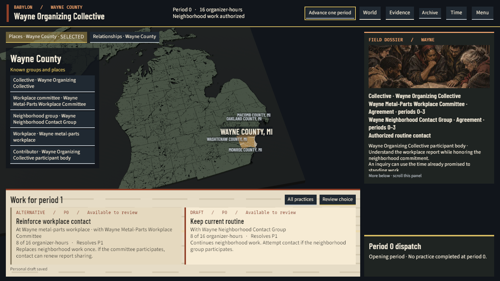
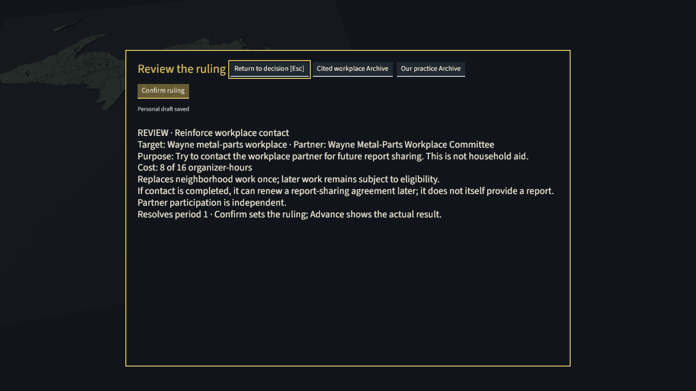
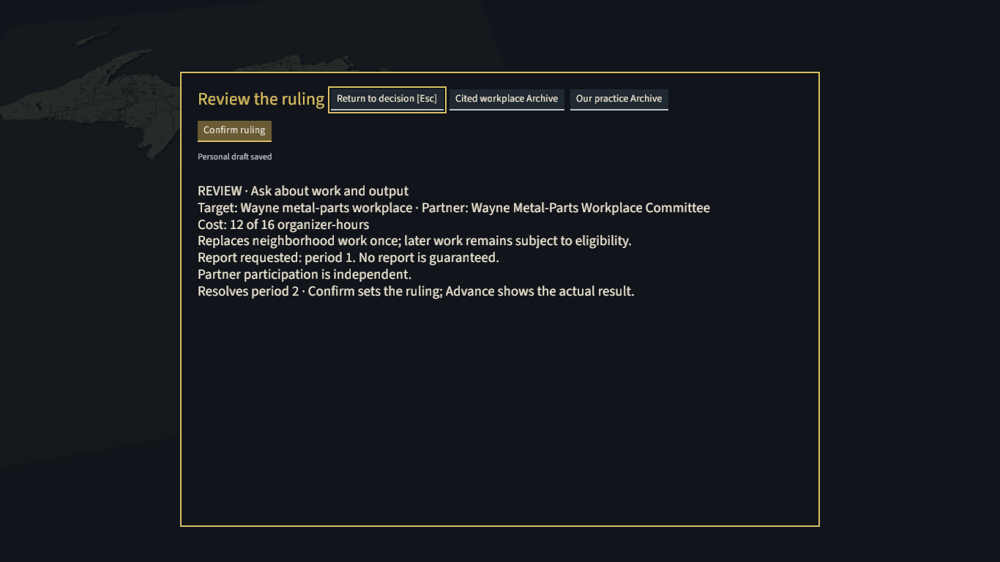
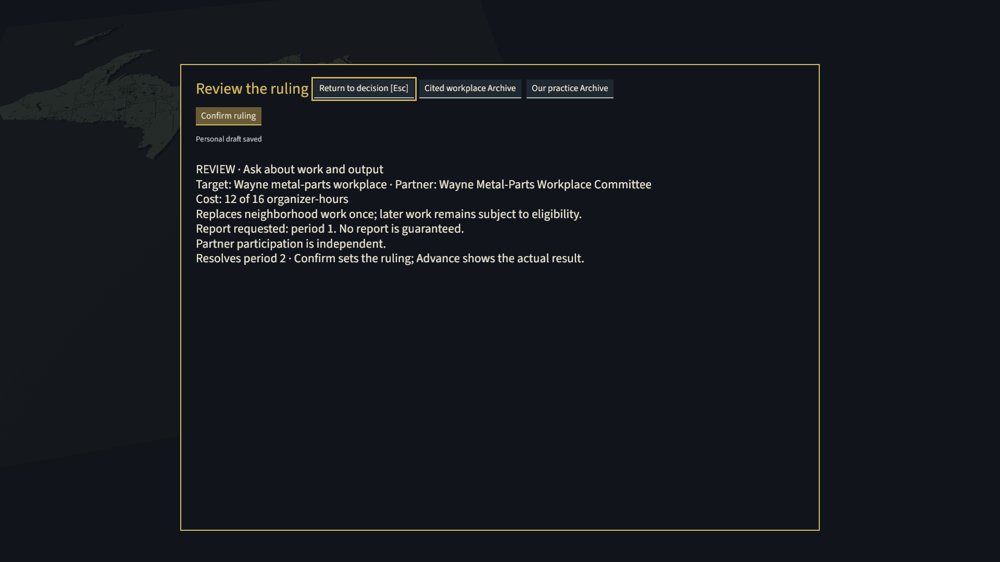
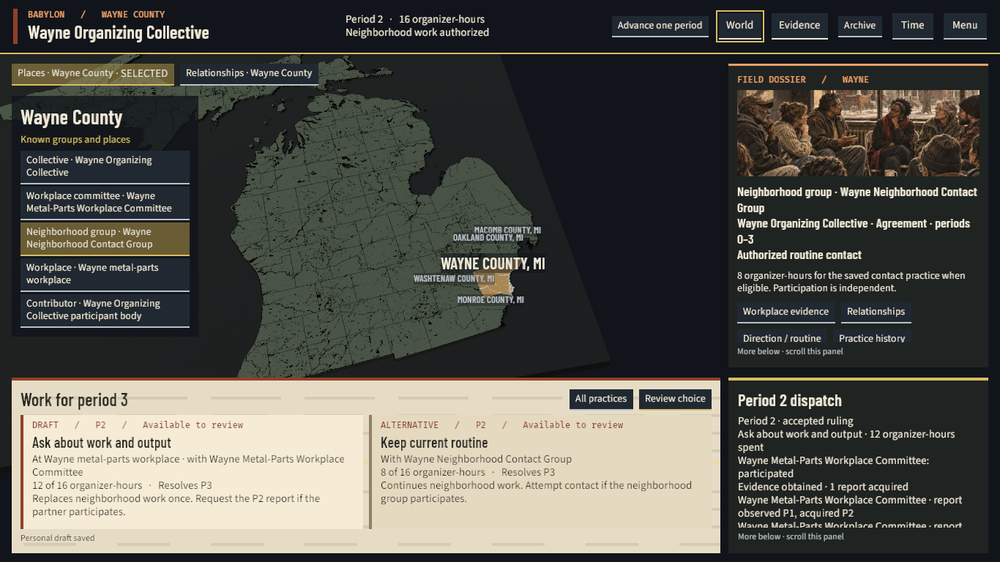
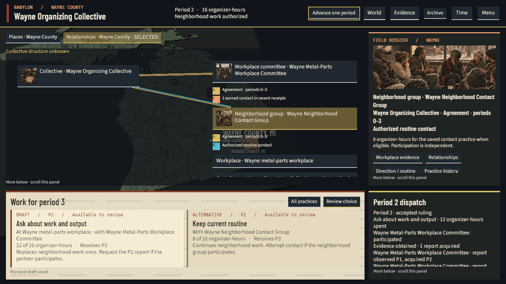
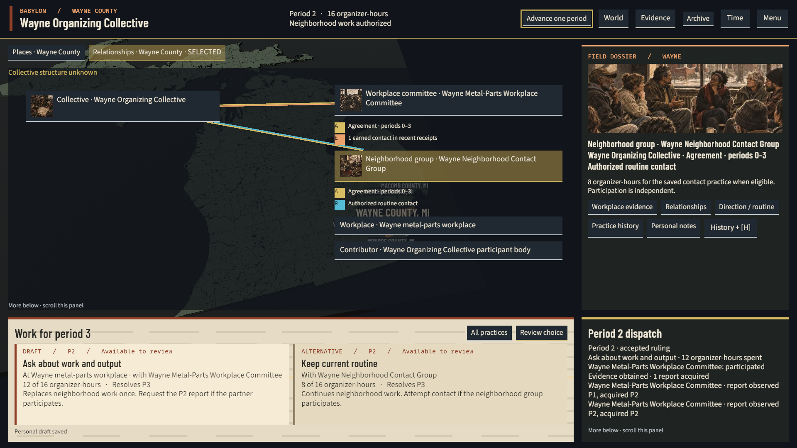
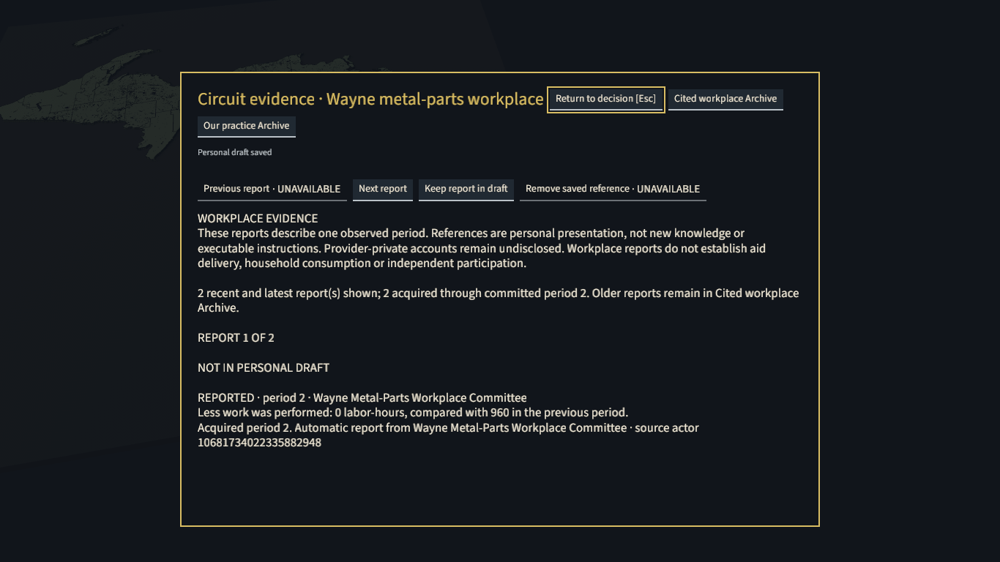

# Wayne game workspace evidence — November 5, 2026

The bounded Michigan organizer workspace completed two real decisions and a distinct
process restart at source `471ca1e228840e1ae4e12f19b6f3203fb5be1689`. The implementation agent
inspected the current map, review, dispatch, evidence return and Relationships
captures and found no remaining material pixel blocker in this slice.
The original run exited `143` after P1. The result below records recovery of
that retained campaign. This record describes an interrupted and recovered run.
Broader acceptance and final publishing gates remain open.

Part of PER-292, PER-331 and PER-302. This report records evidence for the
[canonical design](../docs/superpowers/specs/2026-11-03-wayne-map-and-relationships-design.md).

## Observed player path

The normal **Michigan · organizer control** preset, `organize-in-wayne`, supplied
16 organizer-hours per period. Existing mechanics governed all costs and results.
The final caption and dispatch repairs changed presentation, not mechanics.

| Boundary | Actual action and evidence |
| --- | --- |
| Opening P0 | Places, captured subjects and the two-choice deck were visible. The dispatch correctly said no practice had completed at P0. |
| P1 | Review and Confirm accepted Reinforce workplace contact for 8 of 16 hours. The durable P1 marker consumed that exact command and produced the workplace partner receipt. |
| Interruption | The outer command exited `143`. Its cause remains unknown. The admitted native processes were absent and the owned database retained exactly P1. The evidence retains the missing clean original exit. |
| Recovered P1 | A separate normal Open recovered the same campaign and the same foundation, marker, packages, checkpoint and organizer state. Original native Review/Confirm matched the stored P1 command and commitment bytes. P1 was not replayed. |
| P2 | Review and Confirm accepted only the remaining Work Lost inquiry, for 12 of 16 hours. Each durable marker records its matching consumed command. The acquired report distinguished observed P1 from acquired P2. A separate current P2 observation was also retained. |
| Cold P2 | The recovered pair quit. The runner reaped both processes with exit codes zero. Distinct same-binary processes opened P2 with zero advances, recovered equal authoritative storage and organizer evidence, then quit. The runner reaped both with exit codes zero. |

Evidence navigation preserved the viewed period and draft. Selecting the
neighborhood subject in Relationships preserved the captured workplace action
target. The current-period dispatch exposed the actual participant response,
hours and dated report, with a visible continuation cue. Evidence and receipt
inspectors supplied the longer reading paths.

The workspace retained visible World, Evidence, Archive, Time and Menu routes,
plus All practices. Missing or undisclosed facts remained unknown. Current
receipts and dated history retained separate roles. This control did not add a
City PD encounter or expand a reader's authority. Scoped consumer tests cover
stale, hidden and historical restrictions. The screenshots do not prove the
whole privacy or agency matrix.

## Native captures

These eight images copy actual native screenshots without modification. The
1366×768 frames used scale 1. The 1920×1080 frames used scale 1.25. The authenticated
native resize acknowledgement and each image file’s dimensions agreed.

The implementation agent viewed the corrected captions at both sizes and the recovered dispatch, evidence
and return path. Injected production handlers supplied the actions. Physical
mouse and keyboard operation remains unqualified.

Opening Places and two visible alternatives:

Original P1 Reinforce review:

Recovered P2 inquiry review at both native sizes:

Committed P2 dispatch:

The distinct cold process recovered readable Relationships captions and selection:

The cold process also recovered the dated inquiry evidence:

The [October 29 accepted baseline](gameplay-delivery-audit-2026-10-29.md) is a
visual comparison only. Its review shared a narrow right column with other
controls. The current workspace places two alternatives together below the map,
uses a selected-subject dossier and retains a separate current-period dispatch.
The older campaign's two-hour terms do not supply this control's 16/8/12-hour terms.

## Qualification and retained limits

| Check | Evidence and limit |
| --- | --- |
| Current source checks | 602 client library tests and 8 decision-surface tests passed. Format, client all-target Clippy and all BSL sentinels passed. The required Python gate passed with 3,316 tests and 18 skips at the captured source. |
| Layout and input consumers | Real-font component checks cover the supported sizes, larger settings, clipped text and input exclusion. Native 1920×1080 at scale 1 and larger-text settings were not exercised by this adapter. |
| Recovery | The real persistent-TTY recovery recorded standard input as a TTY, clean recovered/cold exits and 504.86 seconds elapsed. The original command used the default non-TTY mode. The operator did not record its whole lifetime. Neither mode explains the unknown `143` cause. |
| Human acceptance | The implementation agent reviewed current pixels. Physical input, unfamiliar-player understanding and enjoyment remain pending. |
| Publishing | Final whole-branch publishing gates and exact-head CI remain pending. This report closes no broader game milestone. |

The separate national run **failed**. Its first advance took 154.934 seconds.
Archive took 302.080 seconds, exceeding the unchanged 180-second Archive limit.
Elapsed time exceeded the unchanged 900-second routine budget. The
national fixture ultimately stored P2, but its UI installed only P1 and no
separate-process cold proof completed there.

The Michigan control does not qualify national performance, aid accounting, 52/325-period play or memory policy.
Original national timings, failure and policy remain unchanged.

## Provenance and retirement

The current client SHA-256 is
`9967702fb41becf191f53ab1ee588df1f04d3c80ae7498862ea8abd72dd217f7`.
the runtime SHA-256 is
`42be013a88b51cc3788daf0d80516d9fc10686963c2f812af2add4159c8ae13b`.
The genuine recovered completion is `bounded-recovery-completion-v2.json`,
SHA-256 `e57cee6e217f2b6aa1fb8d445a0e17f6255e943508deb7fe5981527eed2d352d`.
It explicitly retains original exit `143`, absent original clean-exit evidence,
and the recovered Open P1 → P2 → Quit → distinct cold P2 chain.
The evidence contains no pristine version-one completion.

The operator retained the full owned database and cluster role settings privately. An actual
restore into a separate verification database succeeded and matched the genuine
final snapshot. The operator then dropped that verification database. Exact container
and network retirement then completed with absence proofs and no live admitted
native processes or other database clients. The recovered retirement receipts
bind the accepted completion and the retained reviewed lifecycle code.

The operator retired all task-owned disposable fixtures. Validated backups,
original failures, raw frames, source capsules and operators remain local.
Michigan control PGDATA and XDG state remain local. Exact national retirement
removed its media directory after retaining the full backup. The protected P7
owner hash remained unchanged, and the shared database service remained healthy.
This public report includes no connection strings, database dumps, cluster role
settings or private credential files.
