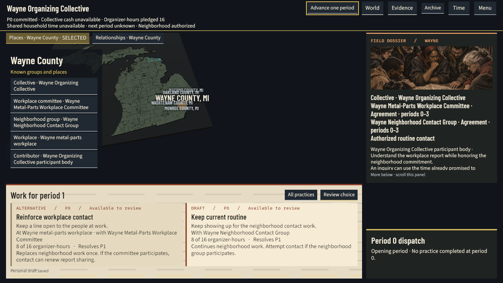
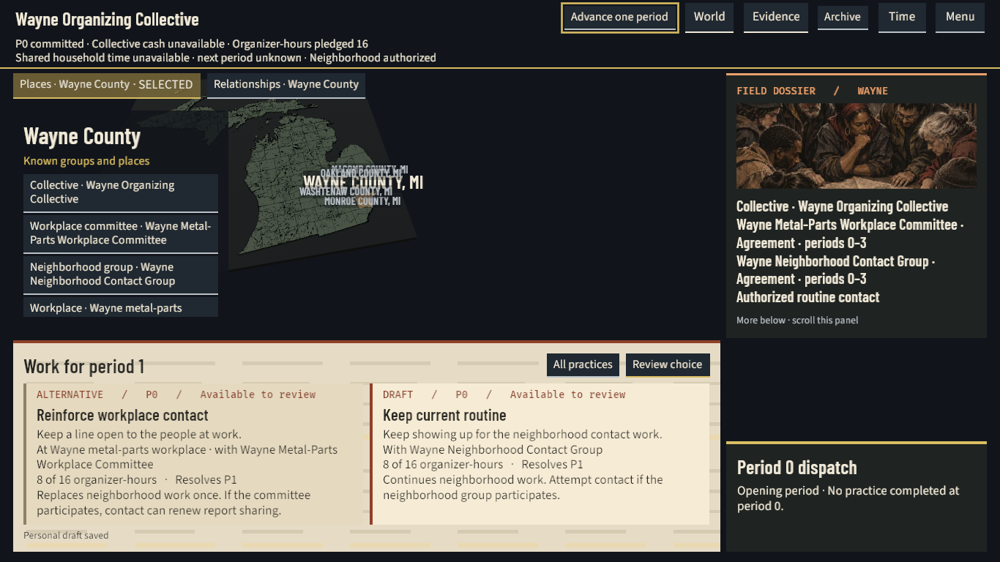
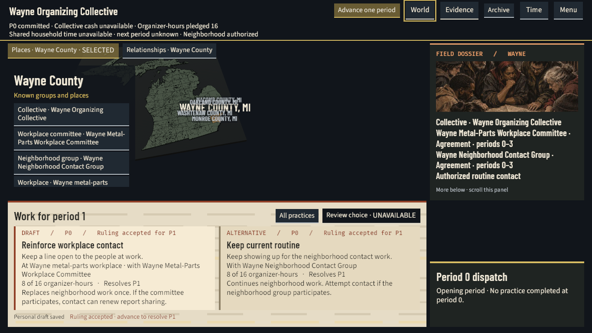
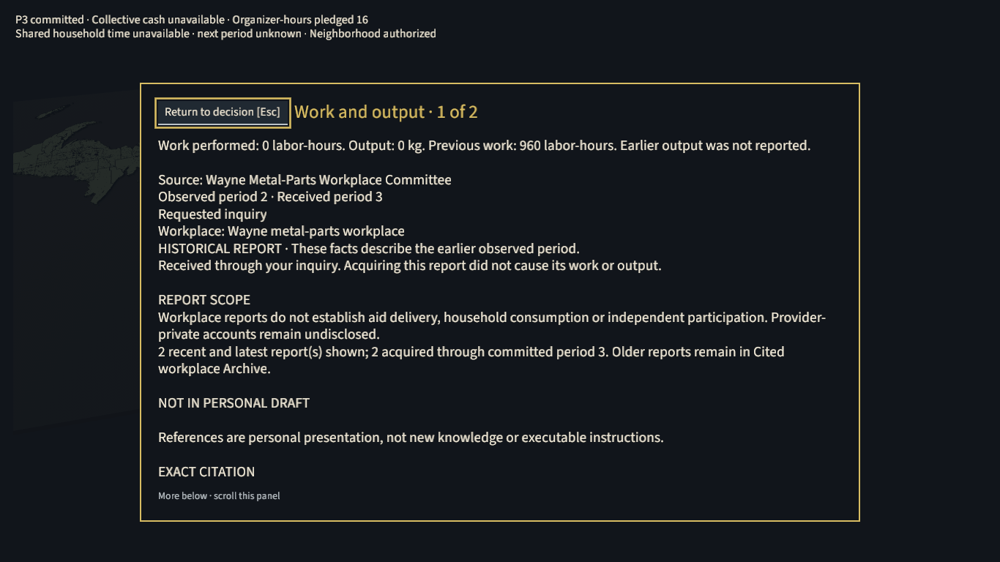
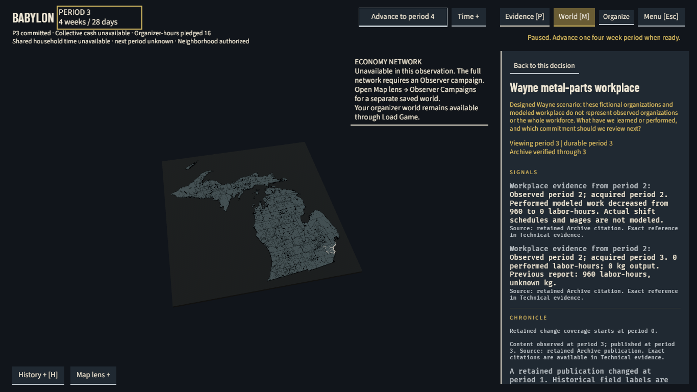
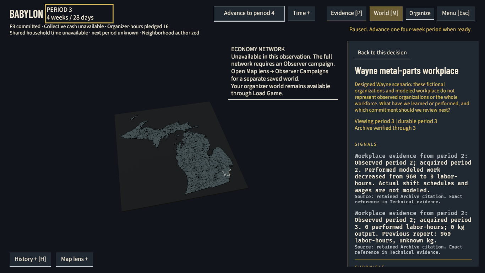
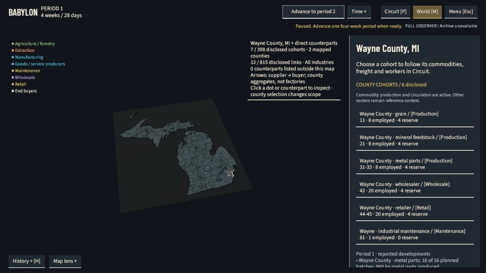
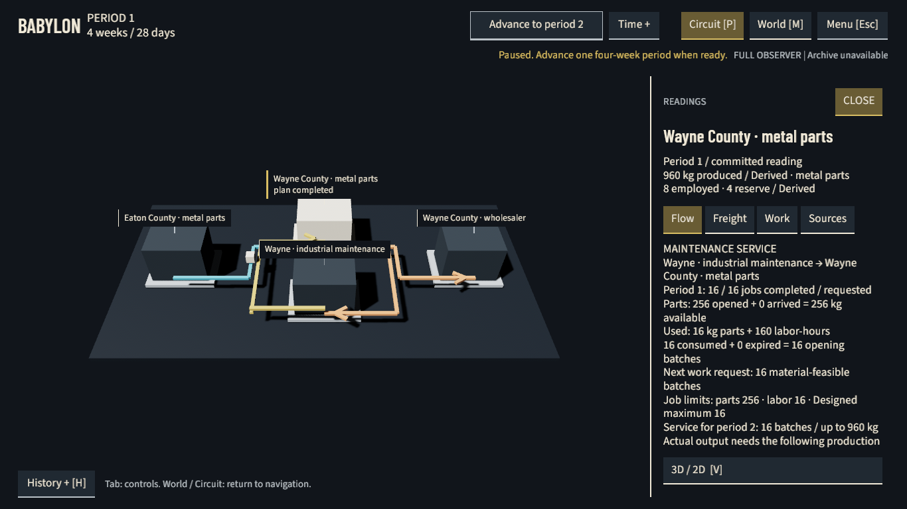

# Wayne play test follow-up evidence — November 6, 2026

The organizer now keeps admitted resources visible, formats exact money and counts,
explains intended work beside its cost, and continues Play through routine periods.
Workplace and World/Archive readers present readable answers, values and dates before
technical references. The full economy network has an explicit route to a separate
observer campaign. New native evidence verifies these existing player paths and the
repairs to both visible choices, the period header and the wrapped network notice.

The Director's earlier session found the composition visually better, but resources,
controls and reports still caused friction. That session ended at period 3. Its
feedback prompted these repairs. No post-fix human play session has qualified them.

Part of PER-292, PER-331 and PER-302. The
[canonical design](../docs/superpowers/specs/2026-11-03-wayne-map-and-relationships-design.md)
remains the authority. The [November 5 report](wayne-game-workspace-2026-11-05.md)
and its images remain unchanged. This bounded result closes no broader game gate.

## What changed for the player

The shared resource header distinguishes collective cash, captured organizer-hours
and dated shared household time. It uses only the admitted current context.
Duplicate aid mandates do not multiply one household budget, and a closed-period
receipt does not promise next-period capacity. Cash is a collective account, not a
personal wallet or a new volunteer pool.

Money uses exact common-currency display, including `$1,234.56`, `-$1.20` and
`$0.000001`, without floating-point rounding or a conversion to USD. Physical
quantities use grouped digits. Identifiers, hashes and dates remain exact.

**Michigan has no treasury or shared household-time bindings.** Its native header
correctly says unavailable, not zero. Known money/time values and long values have
producer-faithful component and shipped-font checks. This preset did not exercise
native cash-rich acceptance.

Comparison cards, All practices and authenticated review share short intent flavor.
Actual targets, partners, costs, displaced routine, resolving period and conditional
consequences remain readable. Flavor does not assert consent or guarantee a result.
Review, Confirm and Advance remain separate.

Play now waits for both the installed observation and authenticated organizer Status,
then continues routine work. It does not resubmit a consumed one-off ruling from the
personal draft.

Pause stops future scheduling. An already detached atomic period can finish once.
Advance remains one period. Reading and review pause Play. Speed controls its delay
between ready periods.

Newly admitted current City PD notices pause once, while old, repeated or stale
notices do not. This native run produced no such notice. That interruption behavior
has source/component evidence only.

The workplace inquiry reader leads with the selected answer, named source and
observed/received dates. Return stays outside its reading region and preserves the
subject and draft.

World shows reports the collective actually earned. Archive shows
retained human labels, values, report dates and publication dates. Exact identifiers,
locators, grant keys, hashes and raw publication remain in optional Technical evidence.
The retained model lacks separate source titles or historical labels in some paths.
The interface states that limit. The native run did not toggle Technical evidence.

The organizer's unavailable network explains the knowledge boundary and opens the
existing Observer Campaigns chooser. A separate saved observer world supplies the
full network. The organizer world stays available through Continue or Load Game.
The route grants no observer knowledge to the organizer.

## Actual native result

RUN-02 used compiled source `2bd365e98e48541ff37acea2042834a2d18b2ded` and normal
launch binaries. Injected controls invoked existing ordinary handlers. The result is
an actual native rendering and bounded behavior witness, distinct from physical
mouse/keyboard, screen-reader or human acceptance.

| Boundary | Observed result |
| --- | --- |
| Opening | Both alternatives showed their titles, actual parties, 8-of-16 organizer-hour costs, period 1 resolution and essential consequences in all four fitted variants. |
| Automatic Play | The client installed consecutive periods 1 and 2, with matching viewed/durable/organizer periods, Play active and no pending work or Status due. Contiguous DB markers agree. Runtime Ready or durability alone was not counted as installation. |
| Pause and Advance | Pause settled at period 2. One manual Step committed and installed exactly period 3, paused. The engine consumed Reinforce once at period 1 and the separately accepted inquiry once at period 3. |
| Exact inquiry | Dispatch and ordinary shell Evidence selected Work and output, observed period 2 and acquired period 3. Its answer is 0 labor-hours and 0 kg. Previous work is 960 labor-hours. The report has no earlier output value. |
| Companion report | Reduced work carries observation and acquisition dates of period 2. There was no new automatic period 3 report in this run. |
| Archive | The paused wait reached verified = durable = viewed period 3 after 32.779396927 seconds from manual Step start. The unchanged limits were 180 seconds for Archive and 900 seconds for the whole run. Actual workplace logs then showed Ready content at period 3. |
| Dates and Return | The actual Archive page lists period 3 as its observation and publication date. Its earned reports retained their separate period 2 observation dates and period 2/3 acquisition dates. Report identity, selected committee/current choice and draft bytes survived ordinary Return. |
| Separate observer | FullObserver installed period 1, selected Wayne, traversed All → Manufacturing and opened the disclosed metal-parts Flow. Its authoritative snapshot stayed the same at period 1 after Flow. |
| Exits | Both client/runtime pairs quit normally, all four exits zero. The bounded functional run took 221.092861579 seconds. This is not a national performance result. |

The inquiry ID is
`758cdaa5f01d2ba5efd9b180f5fc92a1766d676b80adc3641e267a49a7cbf899`.
The separate Reduced work ID is
`2e0d78bef369c909cb92debe25a62271a10087e00e9f5f1a0e3e47e621111c0a`.
Archive convergence preserved the exact campaign, scope, generation, material/world
identity, perspective, selection and draft. Ordinary page admission retained one
not-yet-admitted refusal before success. Ready page logs and readable signals support
fresh content independently of the verified watermark.

## Unmodified native captures

These eight copies match the original PNG bytes and are each at most 1,048,576 bytes.
The agent personally viewed every selected original. Standard 1366×768 uses scale 1.
Larger 1366×768 uses 1.15. Larger 1920×1080 uses 1.4375.

The complete private matrix also includes Standard 1920×1080 at 1.25. Source/component checks and independent
native review cover all four fitted variants.

Opening period 0, Larger 1920×1080 at 1.4375: both alternatives and their complete
terms are initially visible, with the actual unavailable cash/time header.

The same opening, Larger 1366×768 at 1.15:

Period 0, Larger 1366×768 at 1.15: Review and Confirm accepted Reinforce for period 1.
The ruling still awaits a separate advance. This image does not show performed
period 1 work.

Period 3, Larger 1366×768 at 1.15: the requested Work and output answer comes first.
Its named source, period 2 observation, period 3 receipt and fixed Return follow.

World/Archive at period 3, Standard 1366×768 at 1: both earned signals and content
observed/published at period 3 are visible. The focused period and resource lines
are separate, and the unavailable-network explanation finishes above its divider.

The same Archive, Larger 1366×768 at 1.15: both signals and their report dates are
readable. Chronicle and publication detail continue below the indicated scroll fold.

Separate FullObserver period 1, Standard 1366×768 at 1: Wayne and its disclosed
counterparts, with All industries selected. This is not organizer knowledge.

That separate observer's period 1, Larger 1366×768 at 1.15: actual metal-parts and
maintenance Flow follow the Manufacturing filter and cohort selection. The period does not advance.

The default organizer atlas is now more withdrawn, and neighboring county labels
crowd, especially at Larger 1366. Wayne and the known actor controls remain
identifiable. Independent source review found the map area, Home and picking consumers aligned.
Physical picking usability still needs human testing. This is a minor presentation
limit, not a completed map-polish claim.

## Earlier run, recovery and retained limits

RUN-01 at `5af876d3c06a1a5f8c4e409da2e481620a0349bb` completed the bounded functional
path, but its Larger layout hid the second choice. The focused period crossed the
resource line, and the network divider crossed wrapped text. Archive showed retained
period 1 content while viewing period 3. Its functional result remains **visually
LIMITED**, with the original frames, pending content and full backup preserved.

RUN-02's new pixels close those three rendering defects and give the fresh
period 3 Archive witness. This does not rewrite RUN-01 or claim an Archive engine
repair. The added wait used existing background processing and existing observations.

The operator restored RUN-02's full 14,472,221-byte database dump into a distinct
verification database with exit zero. Both original authoritative snapshots contained campaign data. They matched the
restored and actual functional terminal snapshots: organizer period 3 and observer
period 1. The operator then dropped the verification database.

Exact owned container and sole
empty network retirement completed with zero other clients and all four admitted
native incarnations absent. PGDATA, XDG state, full backup, source capsule, logs and
all 56 raw images remain local. Oversize chooser originals remain private unchanged.

Checks found the protected P7 and separate human period 3 file hashes unchanged. This is not a fresh snapshot of either protected database. Connection
strings, credentials, dumps, owner manifests and the human draft stay out of this report.
The [November 5 national failure](wayne-game-workspace-2026-11-05.md#qualification-and-retained-limits)
and its timing limits remain unchanged. This follow-up did not restore or qualify it.

The compiled source passed 628 client tests, eight decision contracts, formatting,
strict all-target Clippy and BSL sentinels. BSL retained 168 report-only advisories,
including two explicit test-matrix flags. Known-value resources and long-label/report
reading have real-font component evidence. Earlier focused Python control checks
passed. Publishing qualifies the exact PR head separately and records those results
in PR #1052. This documentation-only delivery ran no new test or build.

Physical input, screen-reader experience, post-fix human comprehension/enjoyment,
native known cash/household-time values, national performance and broader Gate 3
acceptance remain open. The next game priority is a reported condition leading
to a resource-funded commitment, an independent partner response, and visible later
material or social follow-up. This work adds no new mechanic or AI capability.

## Provenance

The qualification belongs to compiled source `2bd365e98e48541ff37acea2042834a2d18b2ded`.
This report and image copies are a later documentation-only change. Final publishing
pins that documentation head separately. These copies do not form another native qualification.

| Compiled executable | SHA-256 |
| --- | --- |
| Normal client | `9bf1be890a2449a49b703a6b0a52dd1f3cb1a261b67428e12e2857672aa9b8f8` |
| Normal runtime | `42be013a88b51cc3788daf0d80516d9fc10686963c2f812af2add4159c8ae13b` |

The operator retains raw proof locally under
`reports/test-results/wayne-playtest-bounded-native-20261106-02/`.
The following are proof references, not copies of private operator records.

| Local proof | SHA-256 |
| --- | --- |
| `bounded-functional-completion.json` | `88434bbe55ba5673cecb7155e8b22afe3eafba4e68b7744f71300648e8e7c091` |
| `functional-native.log` | `7ee699e73e6f38e4451a6c630f5124a1755d79f01dddb2191f4da47041880635` |
| `source-input-capsule.tar.gz` | `4d3678b2057afab80b1dce0ee0943419a71e3d23e6823f3a732fd131e009da22` |
| `validated-backup/babylon_test.dump` (14,472,221 bytes) | `6e886744cbc7929119728294e23d72d6efcc865398641081d1f944f7059bf870` |
| `validated-backup/backup-validation.json` | `b1ece6c9fb3abe6c0e53986e27424fa83f0acac2594fe88e9d847e6d30b6760e` |
| `bounded-fixture-retirement.json` | `8cd59a56ad0f5195aceeaee0f490de4b66cccd429f632c2bd6787a5cd6663f6d` |

Public image hashes bind the unchanged copies to raw frame numbers in that run:

| Public image | Raw frame | Bytes | SHA-256 |
| --- | --- | --- | --- |
| `opening-larger-1920.png` | 003 | 805,858 | `33fbe60de7589e8cb97b2eef8866a2d1cae69c7c3f7a29db05acbb5153c43fec` |
| `opening-larger-1366.png` | 004 | 458,481 | `b52194127a6bdf99b42e605213354237103dedf7d331419cd63a1348cbe14073` |
| `ruling-accepted-larger-1366.png` | 008 | 466,293 | `b04dcbd6c8d837b517c54cb636dd8c28b82941d85848d556d0d49a97965c2520` |
| `inquiry-answer-larger-1366.png` | 024 | 279,793 | `df5f4fe5f8f5063de92578dbc774feb41d5232c0ae116b90efbdea588e8673f3` |
| `archive-evidence-standard-1366.png` | 034 | 367,898 | `7391f8f4b1266e6dc790ed80e1f49a0b4354d2a52e739298bed592b1cae6bd3a` |
| `archive-evidence-larger-1366.png` | 036 | 368,764 | `0080be9f5ea6e72afeb9394f5923cb26adb10465995c6a4d4d9810b6d0be2dab` |
| `observer-network-standard-1366.png` | 046 | 342,967 | `2833ed744561399c5eb40f363b41e6fdc4facfc50295e0a49777d761674f7b19` |
| `observer-flow-larger-1366.png` | 056 | 322,949 | `1a2ddf6569ae1998833f8e1ef19b10f9a8ac771dc8a01d267a3c09d062469d19` |
